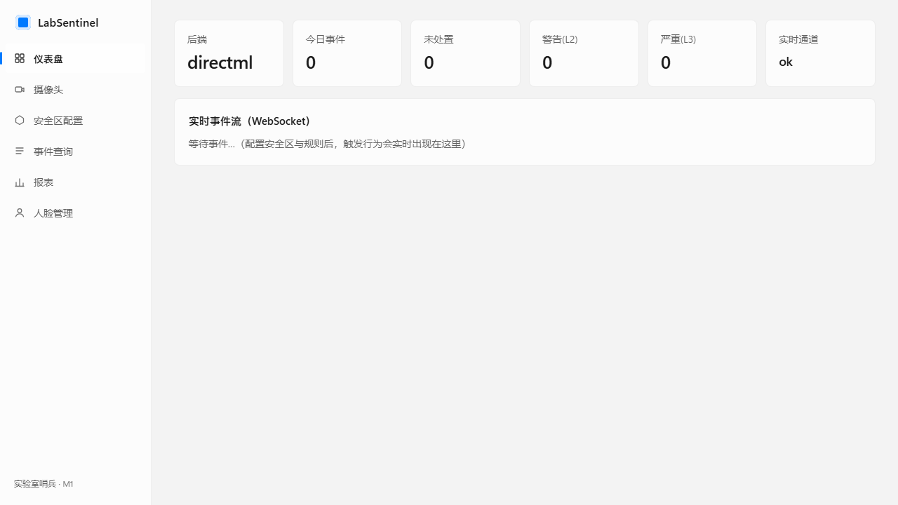
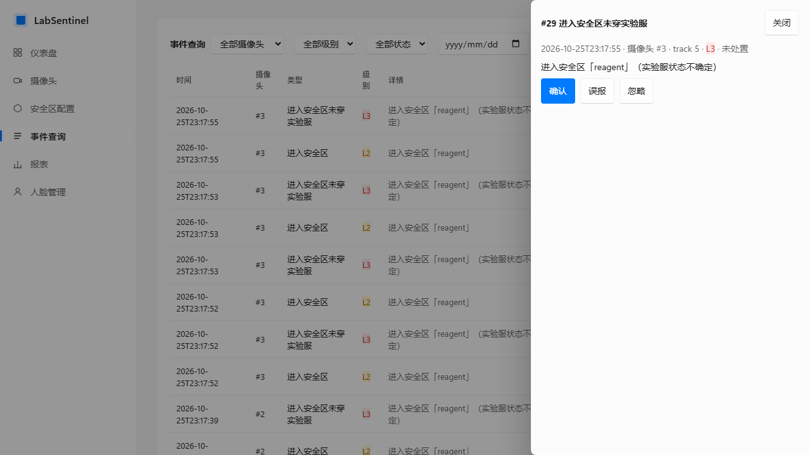
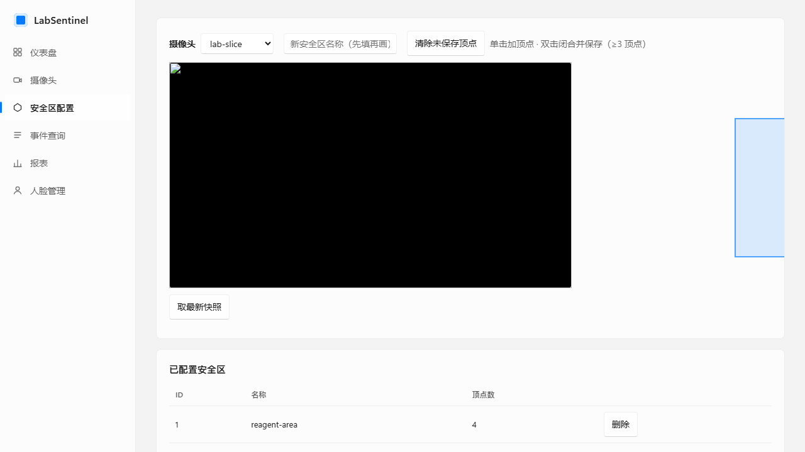
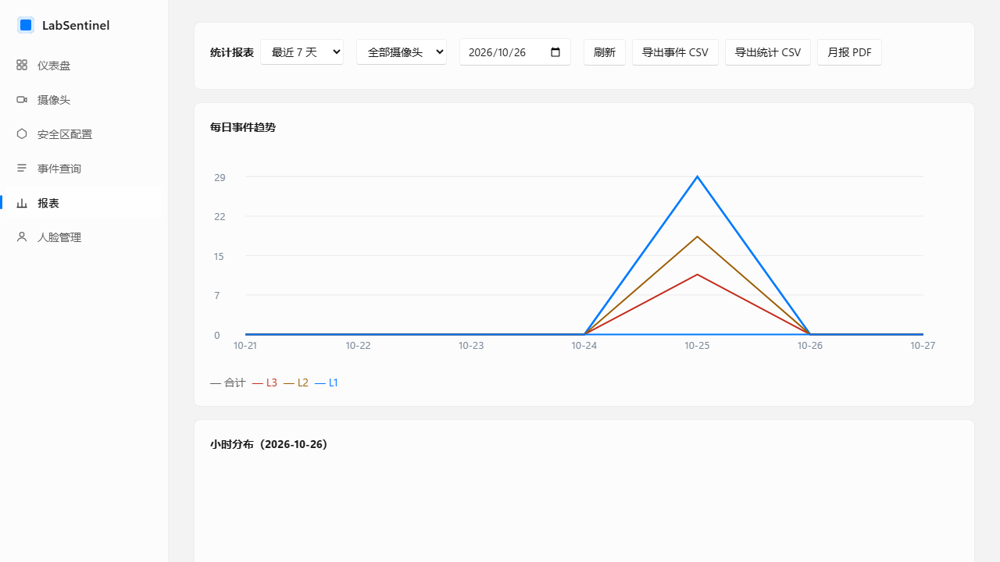

<div align="center">

# 🧪 LabSentinel · 实验室哨兵

**开源实验室安全行为智能监控系统**：接入现有摄像头（RTSP）、USB/视频文件，或外部软件持续截图的图片文件夹，自动识别进入安全区未穿实验服、统计人数，异常实时多渠道告警。全本地部署，隐私可控。

    

</div>

## ✨ 功能一览（30 秒了解）

- 🔍 **白大褂检测**：进入安全区自动判定穿着状态（证据分级判定，不把"看不清"当"违规"误报）
- 🖼️ **图片文件夹自动识别**：外部截图软件持续写入目录 → 自动识别关键图片（有人/违规）并按摄像头/时间汇报，原始截图只读
- 👥 **人数统计**：安全区在场人数统计与超限告警
- 🚨 **事件闭环**：告警 → 确认/误报/忽略 → 误报样本自动进标注池反哺模型
- 📢 **多渠道告警**：企业微信 / 钉钉 / 飞书 / 微信（Server酱·PushPlus）/ QQ（Qmsg）/ 邮件，失败重试+死信可查
- 🖥️ **实时画面**：WebRTC 端到端约 1 秒延迟（go2rtc 网关）
- 📊 **统计报表**：日/小时趋势、CSV / PDF 月报导出（安全汇报直接用）
- 🎥 **视频存证**：事件前后各 2 秒 H.264 短视频，浏览器直接播放
- 👤 **人脸比对**（默认关闭）：CompreFace 集成，注册人员识别与陌生人告警，合规红线齐备
- 📱 **移动端**：Flutter 客户端骨架（M2）
- 🎛️ **双主题 UI**：WinUI 3 设计令牌，浅色/深色随系统

## 🖼️ 界面预览

| 仪表盘 | 事件查询与处置 |
|---|---|
|  |  |
| **安全区配置** | **统计报表** |
|  |  |

> 更多截图见 [docs/assets/](docs/assets/README.md)（共 5 张，含人脸管理页）。

## 🚀 快速开始

### 方式 A：便携包（推荐，Windows 双击即用）

下载 `LabSentinel-portable-*.zip` 解压 → 双击 **`安装.bat`**（生成桌面/开始菜单快捷方式）→
双击桌面 **LabSentinel**（或包目录里的 `LabSentinel.exe` / `启动.bat`）→ 浏览器自动打开控制面板。

- **不需要安装 Python/Node**（包内自带嵌入式运行时与全部依赖），安装/运行均无需联网
- 首次启动自动播种 4 路演示摄像头，开箱即可看到检测效果
- `LabSentinel.exe` 为无控制台启动器（.NET Framework 4.x 系统自带），黑框脚本版 `启动.bat` 保留为脚本入口
- 数据在 `%LOCALAPPDATA%\LabSentinel`；`LabSentinel.exe --stop` / `停止.bat` / `卸载.bat` 可停服与干净卸载
- 详见 [docs/59-portable-install.md](docs/59-portable-install.md)、[docs/58-packaging-strategy.md](docs/58-packaging-strategy.md)

### 方式 B：源码部署（开发模式，Windows）

```bash
# 1. 服务端（Python 3.10+）
cd server
pip install -r requirements.txt -i https://pypi.tuna.tsinghua.edu.cn/simple
python -m uvicorn app.main:app --port 8000

# 2. Web 端
cd web
npm install --registry=https://registry.npmmirror.com
npm run dev     # http://localhost:5173（API 已代理到 8000）

# 3. 浏览器操作：添加摄像头（视频文件/RTSP/USB/图片文件夹均可）→ 安全区配置画多边形、加规则 → 启动 → 仪表盘看实时事件
```

一键脚本（自动体检/部署/端口检测/日志落盘/健康检查/停止）：见 [scripts/README.md](scripts/README.md)；
源码部署由 `scripts/deploy.py` 播种演示数据，便携包由 `scripts/portable_launcher.py` 首次启动自动播种。
`一键启动.bat` 属于**源码/开发模式**；若机器上没有 Python 且已构建便携包，它会自动改为启动便携版。

Docker 部署与完整生产化指南（含摄像头 RTSP 模板、告警渠道申请、合规自查清单）：
**[docs/部署指南.md](docs/部署指南.md)**。

## 🧭 文档索引

| 文档 | 内容 |
|---|---|
| [docs/部署指南.md](docs/部署指南.md) | Windows/Docker 部署、摄像头接入、告警配置、合规自查 |
| [docs/运维手册.md](docs/运维手册.md) | **部署后日常运维一本通**：巡检清单/排障/备份恢复/升级回滚/故障速查 |
| [docs/发布核对报告.md](docs/发布核对报告.md) | 发布前核对与终检记录（版本/校验和/阻塞项） |
| [docs/部署FAQ.md](docs/部署FAQ.md) | 踩坑集中答疑（网络/依赖/推理/训练/告警）；启动失败先跑 `python scripts/doctor.py` 自检 |
| [docs/68-image-folder-ingestion.md](docs/68-image-folder-ingestion.md) | **图片文件夹自动识别使用手册**：截图目录接入、关键/违规定义、配置与排障 |
| [docs/30-architecture.md](docs/30-architecture.md) | 架构总览（线程模型、推理锁机制、扩展点） |
| [docs/35-api-reference.md](docs/35-api-reference.md) | REST/WS API 完整契约（客户端开发唯一依据） |
| [docs/45-model-onboarding.md](docs/45-model-onboarding.md) | 模型接入手册（换模型零改代码） |
| [docs/50-tasks/](docs/50-tasks/README.md) | AI 协作任务包体系（子代理工作分发中心） |
| [docs/90-data-flywheel.md](docs/90-data-flywheel.md) | 数据飞轮：模型持续变强的闭环 |
| [GLOSSARY.md](GLOSSARY.md) | 领域术语表 |

## 📁 仓库结构

```
server/          FastAPI 服务端（推理引擎/跟踪/规则/事件/告警）
web/             Vue3 Web 客户端
android/         Flutter 安卓客户端骨架
tools/           训练/量化/标注工具链 + go2rtc 网关 + ffmpeg
docs/            规划、需求、预研、架构、API、任务包、部署指南
datasets/        数据集（不入库，下载/合并脚本在 tools/）
scripts/         启动/停止/健康检查脚本
m0-spike/        M0 技术验证记录（历史保留）
```

## 🔒 环境变量（前缀 LS_）

完整清单见 [server/.env.example](server/.env.example)。常用：

| 变量 | 说明 | 默认 |
|---|---|---|
| LS_BACKEND_ORDER | 推理后端降级顺序 | directml,vitisai,cpu |
| LS_ANALYSIS_FPS | 每路分析帧率上限 | 5.0 |
| LS_WECOM_WEBHOOK / LS_DINGTALK_WEBHOOK / LS_FEISHU_WEBHOOK | 群机器人 webhook | 空=不启用 |
| LS_SERVERCHAN_SENDKEY / LS_PUSHPLUS_TOKEN / LS_QMSG_KEY | 微信/QQ 推送 | 空=不启用 |
| LS_ADMIN_TOKEN | 管理令牌（写操作保护） | 空=不启用 |
| LS_RETENTION_EVENTS_DAYS | 事件/截图/视频保留天数 | 180 |
| LS_FACE_ENABLED | 人脸比对开关 | **false** |

## ⚖️ 开源协议

AGPL-3.0（与 Ultralytics 生态联动决策见 docs/adr/0001）。模型与数据集不随库分发，由部署者自行下载并遵守其协议。
运行时组件协议：go2rtc MIT、ffmpeg（tools/ffmpeg 为 GPL 构建）、OpenH264（Cisco BSD-2+专利授权，二进制由部署者下载）。

## 🛡️ 合规提醒

人脸比对模块**默认关闭**；开启前必读 [docs/部署指南.md](docs/部署指南.md) 合规章节（单独同意 + 现场显著标识 + 备案阈值 + 一键清除）。
部署摄像头请设置显著提示标识，遵守《人脸识别技术应用安全管理办法》与 PIPL。详见 docs/20-research/00-synthesis.md 第 7 节。
