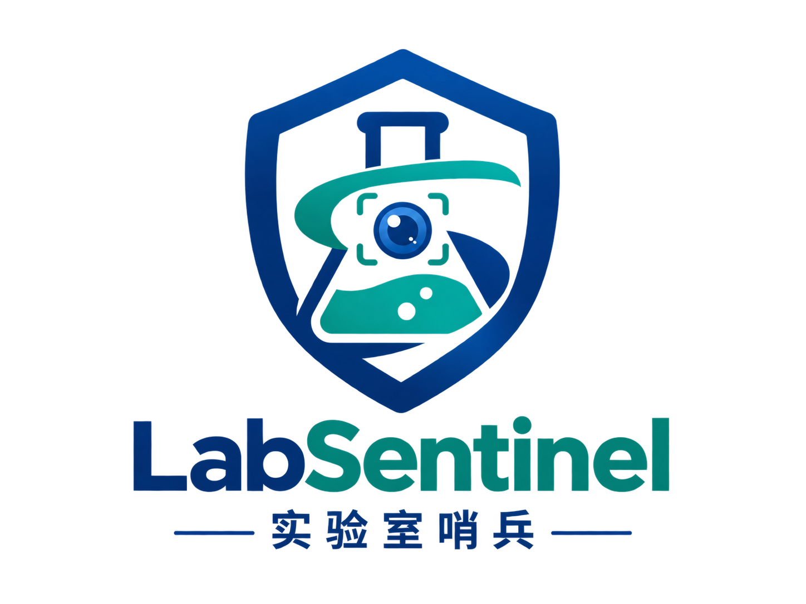
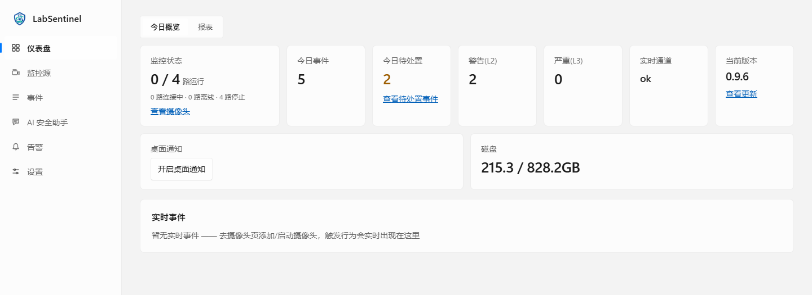
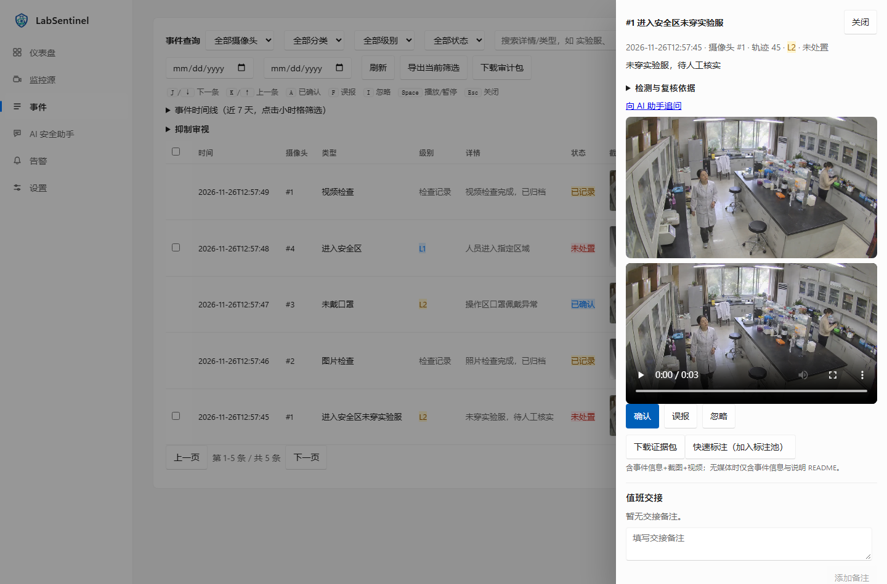

<div align="center">



# LabSentinel · 实验室哨兵

接入现有摄像头和本地素材，检测实验室人员、白大褂、口罩与区域违规，发出警示并保留可复核的事件证据。

Windows x64 · Rust · Vue 3 · AGPL-3.0

</div>

## 快速开始

本仓库当前为 **0.9.6 本地候选**。已发布的版本和校验文件可在项目发布页查看。 [GitHub Releases](https://github.com/windyxyz/LabSentinel/releases)

Windows 包面向 Windows 10/11 x64。运行使用包内组件，无需另装 Python、Node.js 或数据库。 [部署环境要求](docs/guide/部署指南.md)

1. **Windows 安装器**。运行 `LabSentinel-setup-<版本>.exe`。个人安装通过托盘打开控制台。全用户安装可选择原生 Windows 服务，在管理员配置后开机值守。 [安装、升级与卸载](docs/guide/安装与卸载.md)
2. **便携 ZIP**。解压至可写目录，双击 `LabSentinel.bat`。随包包含基础检测模型、推理库、FFmpeg、go2rtc 和 Web 控制台。打开 `http://127.0.0.1:8000` 即可查看。
3. **添加来源**。在「监控源」添加 RTSP、USB、视频文件或图片文件夹。预览画面，按需设置检测区域与规则，启动检查后在「事件」查看结果。 [摄像头接入](docs/guide/摄像头接入Runbook.md) · [图片文件夹接入](docs/guide/图片文件夹接入.md)

个人安装的数据默认保存于 `%LOCALAPPDATA%\LabSentinel\data`。安装器覆盖升级前归档旧版，卸载时默认保留数据。调整端口和局域网访问请使用「设置」。 [部署指南](docs/guide/部署指南.md)

## 功能

| 功能 | 使用场景 |
| --- | --- |
| 本地识别 | 人员在场、白大褂、口罩、区域和人数规则。按机位配置检测范围和模型。画面证据不足时显示未知。 |
| 多路监控源 | 接入独立相机或录像机通道，可用主码流预览、辅码流分析。通过授权局域网 RTSP 接入大华；乐橙取流取决于设备型号及固件。 |
| 事件和录像 | 正常检查、告警与恢复均可查。保留截图和触发片段，支持实时大屏、事件回放、导出证据及审计包。连续录像由现有录像机负责。 |
| AI 复核和问答 | 可使用本地视觉服务或配置外部视觉 API 复核，按人合并时窗内的重复请求。支持围绕事件自然语言追问、生成报告和本地语义搜图。 |
| 授权与联动 | 本机访问密码、按机位配对设备、可撤销凭证和逐工具授权的本地 MCP；支持通知渠道、告警重试和外部设备联动。 |
| 样本与空间 | 从事件收集、标注并按类别导出训练样本。按类别查看占用，预览、确认清理或设置自动保留规则。 |

安装包和便携 ZIP 随附人员、实验服和口罩模型。本地识别使用 Windows DirectML，GPU 初始化或执行失败时回退 CPU。支持 Vulkan 的本地候选可在设置中切换试用。可选的离线视觉问答和语义搜图需另备对应权重。人脸比对默认关闭，可经授权配置本地或外部服务。 [模型接入](docs/dev/model-onboarding.md) · [人脸模型与人员录入](docs/guide/人脸模型.md)

## 界面

以下截图由 0.9.6 本地候选生成，使用合成画面和测试事件。

| 控制台 | 事件与证据 |
| --- | --- |
|  |  |

[查看存储管理界面](docs/assets/storage-0.9.6.png)

## 验收范围

Windows 候选已验证照片与视频检查、AMD Vulkan 四路和九路短测、事件回放、以图搜图、机位权限收窄，以及个人安装、覆盖安装、回滚和保留数据卸载。

白大褂检测仍受远景、逆光和遮挡影响。现场通道、异厂显卡、管理员服务和签名在对应环境继续验收。 [当前进度与实测记录](docs/maintenance/progress.md) · [版本路线图](docs/plan/v1.0.0-roadmap.md) · [变更记录](CHANGELOG.md)

## 开发

Rust 后端在 [engine-rs](engine-rs/)，Vue 前端在 [web](web/)。[模型权重](models/)、[构建脚本](scripts/)、[训练工具](tools/) 各有独立目录。[文档索引](docs/) 包含使用指南和维护记录，[本地资源索引](Resources/) 可查发行包、验收、数据集和训练输出。

前端构建产物由 Rust 服务托管。Windows 中文路径的构建配方见接力开发规范。 [开发环境和验证命令](AGENTS.md)

```powershell
# 仓库根目录
npm --prefix web ci
npm --prefix web run build
python scripts/prepare_rust_assets.py

Set-Location engine-rs
cargo run -p ls-server -- --launch
```

Python 用于开发期资产准备、训练和验收。Rust 工作区位于 `engine-rs/`，前端位于 `web/`，部署脚本位于 `deploy/`。 [架构](docs/dev/架构设计.md) · [API 参考](docs/dev/api-reference.md) · [运维手册](docs/guide/运维手册.md)

## 许可

项目按 AGPL-3.0 发布。第三方组件和随包模型的来源、署名及适用许可见声明文件。 [LICENSE](LICENSE) · [NOTICE](NOTICE)
