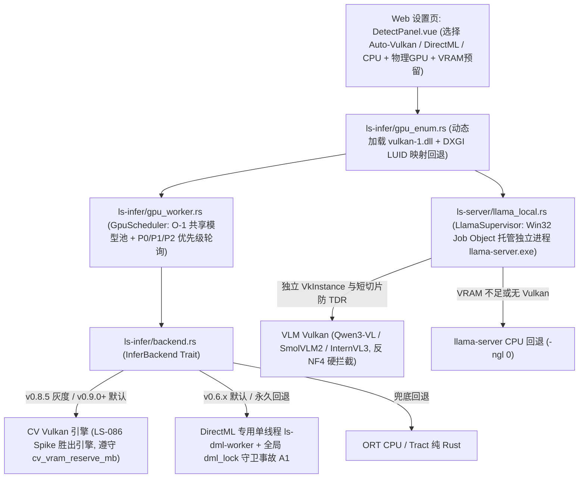

# LabSentinel `v0.6.x → v1.0.0 GA` 总演进规划蓝图（Master Plan）

> **规划基线**：`v0.6.0`（`main @ 2fef1b4`，已完成至 `LS-075`，实码核验 SQLite `SCHEMA_VERSION_LATEST = 22`）
> **状态**：**已审定入库（2026-11-23）**——已同步登记至 `task_plan.md`、`task_registry.md`、`progress.md` 与 `docs/adr/0012-unified-vulkan-gpu.md`（Proposed 草案）。
> **编制口径**：汇总并交叉核验视觉与模型轨（`plan_v1_vision.md`）、AI/VLM/语义检索/MCP 轨（`plan_v1_ai_mcp.md`）、高性能视频/运维/GA 轨（`plan_v1_perf_ops.md`），经 `v0.6.0` 真实 Rust/Vue/SQLite/Inno 源码抽检，已完成全量去重、接口对齐、单调版本号与 `LS-080`～`LS-101` 任务编号统一编排。

---

## 0. 不可违背的架构红线与设计决策

### 0.1 明确纳入的核心必选项（Must-Haves）
1. **Rust-first + Vue 3 单二进制**：所有在线推理、视频采集、规则、VLM 调度、语义检索、MCP 与服务管理均落在 `engine-rs/`（`labsentinel-server.exe`）+ `web/`；`tools/` 与 `scripts/` 永久仅作离线开发/训练/评测/打包支具，不进发行包；严守 `engine-rs/Cargo.toml` 的 `workspace.lints.rust.unsafe_code = "deny"`（必要动态库/C 扩展 FFI 须单文件收口并附 FFI 清单）。
2. **统一 Vulkan GPU 跨厂商路线（CV + VLM，含正式 ADR 修订计划）**：
   - **过渡期（`v0.6.1` ～ `v0.8.0`）**：CV 保持 `DirectML → CPU` 稳定运行，且**永久严守事故 A1 铁律**（DirectML 建会话/`Session::run`/`Drop` 全部收口于专用单 OS 线程 `ls-dml-worker` + 全局 `dml_lock()` + `with_memory_pattern(false)` + `with_parallel_execution(false)`）；`v0.8.0` 率先以原生 **Vulkan** 托管离线 VLM（`llama-server.exe`）。
   - **选型与切换（`v0.7.0` Spike → `v0.8.5` 灰度 → `v0.9.0` 默认）**：在 `ls-infer` 建立插件化 `InferBackend` 抽象，经真机 **Vulkan CV Spike**（`ncnn-vulkan` vs `ort-webgpu/Dawn` vs `wgpu/Burn`）用客观实测锁定胜出引擎并形成 **`docs/adr/0012-unified-vulkan-gpu.md`**（计划修订 `0009-alignment-vs-gpu-and-model-provenance.md` 与 `AGENTS.md` GPU 条款）；`v0.8.5` 开放 `Auto(Vulkan)` 灰度验证，`v0.9.0` 正式将 **Vulkan** 晋升为 **CV + VLM 统一默认跨厂商 GPU 后端**，并**永久保留 `DirectML (dml_lock) → CPU` 自动降级回退链**。
   - **CV + VLM 显存协同**：双方共用统一 Vulkan 物理设备拓扑与显存预留预算，支持同卡分预算或双卡分流（如核显跑 CV + 独显跑 VLM），防 OOM 与 Windows WDDM TDR 驱动重置。
3. **可选托管离线 Vulkan VLM（`llama-server.exe`）**：复用 `ChildGuard`（Win32 Job Object）托管，默认不随发行包内置数 GB GGUF 权重，经 Web 设置页按需引导下载并强制执行 **反 NF4 低比特量化硬护栏**（依据 `arXiv:2603.28888`，防安全异常召回崩塌）。
4. **细粒度可配权限本地 MCP Server**：Streamable HTTP + JSON-RPC 2.0；**默认关闭**；开启后**默认严格全只读**（11 项 Tier-1 只读工具）；Web 设置页「MCP 接入」提供 **9 项 Tier-2 高权限工具逐项独立勾选授权**（含风险分级、高危二次确认与“一键恢复只读”）；Tier-3 高危/提权/人脸 PII 永禁；独立 `mcp_tokens`（拒浏览器 Cookie CSRF）、默认仅回环、严检 Host/Origin、全量审计落库 `audit_log.detail`、并附 HMAC-SHA256 可验证证据凭证 `_receipt`。
5. **弹性小版本节奏与 Windows 双产物体验**：按 `v0.6.1 → v0.6.2 → v0.7.0 → v0.7.5 → v0.8.0 → v0.8.5 → v0.9.0 → v0.9.5 → v1.0.0 GA` 渐进交付；网页内热配置零手改文件；保持 `zip` + Inno Setup 7 `setup.exe` 双产物、干净卸载且默认保留用户数据；正式发布资产走 CI `release.yml`。

### 0.2 明确排除项（Hard Exclusions）
- **绝不做 PDCA 隐患整改工单闭环**：不建 `hazards` / 整改派单 / 整改前后照销号 / 门牌巡检表流程（合规输出聚焦纯视觉/事件审计、热力图、交接备注与防篡改审计证据包 ZIP）。
- **绝不回归 Python 产品运行时**，**不做 Docker / VM / Flutter / Tauri / 安卓 / CUDA**。
- **绝不将 NC/学术受限数据集混入发行随包权重**：严禁 `SH17`（CC BY-NC-SA）、`FASDD`、`URFD/Le2i` 进入随包模型训练（通过自动化许可防火墙在工具层硬拦截 `exit 2`）。
- **绝不以 DETR/Transformer 作为 DirectML/Vulkan 默认随包主检测器**（规避 Int64/动态图算子坑），也不让 VLM 替代确定性本地引擎做主实时检测或无人值守自动控制。

---

## 1. `v0.6.0` 基线实码核验与跨轨冲突消解清单

### 1.1 实码抽检核验结果（基准：`main @ 2fef1b4`）
经对照 `engine-rs/`、`web/`、`tools/`、`deploy/`、`docs/adr/` 真实源码，确认当前 `v0.6.0`（`LS-075`）状态与核心短板：
- **存储与依赖核验**：`ls-store/src/lib.rs:17` 确认 `SCHEMA_VERSION_LATEST = 22`；`rusqlite = "0.41" (bundled)`、`ort = "2.0.0-rc.15" (load-dynamic, directml, half)`、`image = "0.25.10"`、`windows-sys = "0.61"`（`ls-server`）；`ls-store/src/operations.rs` 已内置 `photo_check_images`、`alert_delivery_history`、`event_notes`、`camera_outages`、`compliance_daily`；`audit_log` 表已含 `detail TEXT` 列但尚未被读写方法激活。
- **视觉与精度短板（核验确认）**：`worker.rs:596,651` 随包 `yolo11n_ppe.onnx` 硬关闭灰度 CLAHE 且阈值 `(0.50, 0.40)`；`ppe.rs:362-412` 远景裁剪仍复跑原整图检测器、`labcoat-confirm.onnx` 仅读 class 0 未对比负类且无 256×256 上身二分类复检；`boxes_overlap` 缺 `coverage >= 0.60 & margin >= 0.15` 唯一归属；`ByteTrack` 缺遮挡断轨；`detector.rs` 丢弃同次 COCO 前向的 `cup/bottle/wine_glass/cell_phone`；视频/图片双路径硬编码脚底中点入区。
- **VLM 与控制面短板（核验确认）**：`handlers/events.rs:74-93` 确认 `event_json()` 将 `vlm_verdict` 强映射为 `ai_review` 且读取不存在的 `.verdict`，导致 `ai_verdict` 断层；`detect.vlm_prompt` 仅在 `detect_test` 生效，生产三条链路硬编码 `VLM_PROMPT`；`cascade_is_negative()` 无法抑制“画面有人但已穿实验服”误报；`router.rs` 缺单路停流 `POST /api/cameras/:id/stop` 与单规则启停 `PATCH /api/rules/:rid/enabled`。
- **性能与运维短板（核验确认）**：每路独立持有 ORT Session 造成 $O(N)$ 显存占用与 `dml_lock()` 争抢；前端未呈现 `performance.rs` 已采集的 10 维耗时；`Wall.vue` 缺全局并发流硬上限与 WS `?since=` 断线重放；`ls-jobs/src/lib.rs:549` `alert_image()` 硬校 JPEG 魔数 `0xff 0xd8`（切 WebP 必须兼容）；`worker.rs` 每次事件直接 `thread::spawn` 且非事务 Outbox；`deploy/windows/installer.iss:232` 仍引用未随包的 `tools\winsw.exe`；`NOTICE` 存在 ORT 版本（`1.24.4` vs 实装 `1.20.1`）漂移。

### 1.2 三轨整合中已消解的 6 项交叉冲突
| 冲突项 | 原三轨差异 | 本总计划统一裁决 |
|---|---|---|
| **1. Vulkan CV 晋升默认时机** | Perf-Ops 原表在 `v0.7.0` 提前写 Vulkan 默认；Vision 将 Spike 置 `v0.7.0`、引擎落地置 `v0.8.5`、晋升默认置 `v0.9.0` | 采纳渐进零风险链：`v0.6.1` 建 `InferBackend` 抽象 → `v0.6.2` 落地 Vulkan 物理设备枚举与共享 `GpuScheduler`（仍默认 DirectML）→ `v0.7.0` 真机 Vulkan CV Spike → `v0.8.0` Vulkan VLM → `v0.8.5` Vulkan CV 引擎灰度 → **`v0.9.0` 正式晋升统一 Vulkan 默认 GPU** |
| **2. 配置键命名分叉** | `runtime.ep` vs `runtime.backend`；`runtime.gpu_index` vs `runtime.gpu_id`；`cv_vram_budget_mb` vs `vram_budget_mb` vs `cv_vram_reserve_mb` | 全仓统一标准键：**`runtime.backend`**（`auto_vulkan\|vulkan\|dml\|cpu`，向下兼容读取旧 `runtime.ep`）、**`runtime.gpu_id`**（`auto` 或 LUID/`vulkan:<n>`）、**`runtime.cv_vram_reserve_mb`**（默认 `1024`）、**`llama.vulkan_device`**（`auto` 或 `gpu_id`）、**`llama.vram_budget_mb`**（`0`=自动按余量减 CV 预留计算） |
| **3. `events.snapshot_sha256` 重复迁移** | Perf-Ops (`v0.6.2`/`v0.8.0`) 与 AI-MCP (`v0.7.5`) 均声明增列 | 单一归属 **`v0.6.2`（`LS-083`，Schema `v24`）**随干净 WebP 落盘一并写入；后续 VLM、溯源与 MCP `_receipt` 直接复用 |
| **4. 抑制审计与可解释面板重叠** | Vision (`v0.6.2`) 建 `/api/audit/suppressions`；Perf-Ops (`v0.7.0`) 建 `/api/review/suppressions` 与 `/api/events/:eid/explain` | 统一唯一端点：**`GET /api/review/suppressions`**（`LS-082` 建表与写入）、**`GET /api/events/:eid/explain`**（`LS-085` 建抽屉解释面板，`LS-088` 补 VLM 推理链，`LS-091` 补溯源指纹） |
| **5. 既有历史任务衔接** | `task_registry.md` 存在 `LS-062..065`（Windows 4551 阻塞）、`LS-067/068/070`（v0.6.0 现场暂停）、`LS-900`（签名阻塞） | 新路线图任务严格从 **`LS-080`** 顺序起编至 **`LS-101`**；`LS-070`/`LS-067`/`LS-068` 决定 `v0.6.0` 收口；`LS-062..065` 真机联测项并入 `v0.6.2`/`v0.7.0`/`LS-100` 门禁；`LS-900` 在 `LS-101` 闭环 |
| **6. ADR 文件命名规范** | Vision 草案写作 `docs/adr/ADR-0012-...`；仓库实测命名规范为 `0009-...`、`0010-...`、`0011-...` | 统一采用仓库规范文件名 **`docs/adr/0012-unified-vulkan-gpu.md`** |

---

## 2. 统一版本阶梯与 `LS-080` ～ `LS-101` 总任务表

```mermaid
flowchart LR
    V060["v0.6.0 基线 (LS-075 / DB v22)"] --> V061["v0.6.1: LS-080..081 精度破局与流控HUD"]
    V061 --> V062["v0.6.2: LS-082..083 空间防误报与共享GPU/WebP/PTZ"]
    V062 --> V070["v0.7.0: LS-084..086 片段消警与Vulkan CV Spike"]
    V070 --> V075["v0.7.5: LS-087..088 实验室专项规则与VLM 2.0"]
    V075 --> V080["v0.8.0: LS-089..092 跌倒防篡改溯源与Vulkan VLM"]
    V080 --> V085["v0.8.5: LS-093..094 Vulkan CV灰度与安全技能包"]
    V085 --> V090["v0.9.0: LS-095..097 Vulkan默认与飞轮2.0/语义搜图/零转码"]
    V090 --> V095["v0.9.5: LS-098..099 细粒度MCP与原生服务/审计包"]
    V095 --> V100["v1.0.0 GA: LS-100..101 72h双Vulkan认证与签名发布"]
```

### 2.1 全周期统一任务总表（22 项，零编号冲突）

| 版本 | Task-ID | 优先级 | 归属主轨 | 任务名称 | 核心交付摘要 | 前置依赖 | DB Schema |
|---|---|---|---|---|---|---|---|
| **`v0.6.1`** | **`LS-080`** | P0 | Vision | `InferBackend` 抽象 + **现成权重对照整合** + 两阶段裁剪 PPE 精判/归属/断轨/COCO 互证 | `ls-infer` 建立 `InferBackend` trait (`Vulkan\|DirectML\|CPU\|Tract`)；**先零训练验证现成权重**：补齐随包 YOLOE 正负对照提示词、导出并对照 Apache-2.0 `PP-LCNet` 多属性/现成合规 PPE 权重；落地 256×256 上身裁剪二分类/多属性器 + 长衣上身双窗复检；`coverage>=0.60 & margin>=0.15`；`IoU>=0.35` 遮挡断轨；零开销复用 COCO `cup/bottle/wine_glass/cell_phone`；修复随包模型禁用 CLAHE | `v0.6.0` | `v22`（无变更） |
| **`v0.6.1`** | **`LS-081`** | P0 | Perf/Ops | 并发流硬上限（≤5）+ WS `?since=` 断线重放 + 耗时 HUD + 敏感度预设 | `streamPool.js` 全局 `IntersectionObserver` ≤5 并发流租约与省流快照降级；`/ws/events?since=` 无缝重放；`LatencyHudBar.vue` 展示分阶段耗时与帧龄；网页「保守/平衡/敏感」三档敏感度一键联动预设 | `v0.6.0` | `v22`（无变更） |
| **`v0.6.2`** | **`LS-082`** | P0 | Vision | 空间智能与防误报治理（多锚点 / 死区 / 双层遮罩 / 记住误报点 / 抑制审计） | 4 种入区锚点（含俯拍 `UpperBody`/`FourPointAny`）、边界死区 `margin_px`、12 帧离场宽限；严格分离 Motion Mask（推理前）与 Object Filter Mask（推理后）；静止目标降频；一键记住常驻误报点（生命安全事件永禁屏蔽）；`suppression_audit` 落库与 `GET /api/review/suppressions` | `LS-080` | **`v23`** |
| **`v0.6.2`** | **`LS-083`** | P0 | Perf/Ops | 共享 `GpuScheduler` + Vulkan 物理设备枚举 + 干净 WebP 叠框 + Debug/Digital PTZ | $O(1)$ 全局共享模型池 + 三级优先级单共享 GPU Worker（DirectML 绑专用单 OS 线程 `ls-dml-worker` + `dml_lock()`）；动态加载 `vulkan-1.dll` 枚举独显/核显与 `VK_EXT_memory_budget`（DXGI LUID 映射回退）及 Web 后端/显卡配置 UI；干净 WebP 快照 + 纯 Rust 内存缩略图 + 告警附图转码兼容 + `SnapshotOverlay.vue` 矢量叠框；实时 Debug 叠层 + 纯前端 1×–5× Digital PTZ + 小地图 HUD | `LS-080`, `LS-081` | **`v24`** |
| **`v0.7.0`** | **`LS-084`** | P0 | Vision | 违规事件段聚合、两级宽限倒计时与合规恢复自动消警（`alert_resolved`） | `EpisodeTracker` 连续违规合并为单条事件段（`first_ts`/`last_ts`/`duration_s`/`hit_count`/峰值截图刷新）；在区每 2s 持续重检 PPE；`70% warning → 超时 alert` 两级宽限升级；穿戴/离场连续恢复触发 `alert_resolved` 自动闭合 | `LS-082`, `LS-083` | **`v25`** |
| **`v0.7.0`** | **`LS-085`** | P1 | Perf/Ops | 统一 AI Review 可解释性抽屉与抑制审视面板 | `GET /api/events/:eid/explain` 聚合本地视觉分数/归属边距/区域锚点/片段信息（后续版本无缝挂接 VLM 推理链与溯源哈希）；前端「抑制审视」滚动查看 `remembered_spot`/`filter_mask`/`stationary`/`grace_recovered` 抑制原因并支持一键入标注池 | `LS-082`, `LS-084` | `v25`（无变更） |
| **`v0.7.0`** | **`LS-086`** | P0 | Vision + Perf/Ops | **统一 Vulkan CV 引擎选型 Spike & 真机基准对比** | 独立实验特性 `vulkan-spike` 在真实 AMD（Radeon 880M）/NVIDIA/Intel 显卡上实测对比 `ncnn-vulkan`（`libloading` + `pnnx`，BSD-3）vs `ort-webgpu/Dawn` vs `wgpu/Burn`，覆盖数值等价度、4 路并发吞吐与 4h 并发 VLM 零 TDR，产出 **`docs/adr/0012-unified-vulkan-gpu.md`** 锁定胜出引擎 | `LS-080`, `LS-083` | `v25`（无变更） |
| **`v0.7.5`** | **`LS-087`** | P1 | Vision | 实验室专项规则（1D `ref_lines` / OR-of-ANDs PPE 矩阵 / 协议无关湿实验规则） | 通风橱探身（按人高归一化 `d/person_h > 0.30`）与拉门过高基准线；按机位/区域 OR-of-ANDs 合规 PPE 组合矩阵（2s/3 帧连续合规，消费随包 10 类中的手套/护目镜）；固定机位规则 `INCUBATOR_DOOR_OPEN` / `SPILL_OR_LEAK` / `GLOVE_CONTAMINATION`；告警扩展 `error_code`/`severity`/`confidence_stage`/`suggestion_tts`（≤25 字） | `LS-084` | **`v26`**（与 `LS-088` 合并） |
| **`v0.7.5`** | **`LS-088`** | P0 | AI/MCP | 防幻觉 VLM 2.0 统一引擎 + **性价比多模态 AI 辅助报告、带识图问答与持久化历史** | 合并 `vlm.rs`/`genai.rs` 终结双轨分裂，修复 `ai_verdict`/`detect.vlm_prompt`/`cascade_is_negative` 现网断层；Person 门控休眠 + MD5 去重 + ATS/EVS 3 关键帧采样（省 Token ≥62%）；6 层防幻觉 + 四角色路由（直连 DeepSeek/Qwen-VL-Flash/GLM-4V-Flash 等性价比视觉 API 及本地 VLM）；新增**「AI 安全助手」工作台**：一键生成可归档/导出的**带识图 AI 辅助日/周/月报**、确定性 SQLite 证据路由的**多轮带识图历史安全问答**（首轮 ≤4 张干净原图，后续自动切 `record_only` 省 90% 费用）与持久化会话/报告历史（SQLite 乐观锁 + 事务外远程调用） | `LS-083`, `LS-085` | **`v26`**（与 `LS-087` 合并） |
| **`v0.8.0`** | **`LS-089`** | P1 | Vision | 零 NC 数据集姿态跌倒/昏迷检测 + 可选红外热成像遥测钩子 | 基于 COCO Keypoints（CC-BY-4.0）的 `PoseModel` 四因子几何+静止时长状态机（可选异步 VLM 复核拉升遮挡召回至 ≥90%）；`POST /api/telemetry/thermal` + MQTT 订阅接入 MI48/MLX90640 低分辨红外热成像，`>55°C` 或温升超限 0.3s 超前火灾预警 | `LS-087`, `LS-088` | **`v27`**（与 `LS-091` 合并） |
| **`v0.8.0`** | **`LS-090`** | P1 | Perf/Ops | 摄像头防篡改检测（`tamper.rs`）+ 可选 FFmpeg 音频尖峰旁路 | `160×90` 灰度统计检遮挡/黑屏、强光致盲、无人慢速 EMA+Sobel NCC 视角移位（抗 IR-cut 昼夜切换误报）及自动恢复闭合；可选单路 8kHz PCM RMS 音频尖峰（玻璃碎裂/通风橱蜂鸣）抓拍存证 | `LS-083` | `v27`（无新表） |
| **`v0.8.0`** | **`LS-091`** | P1 | Perf/Ops | 全链路 SHA-256 溯源（`open-nvr` 模式）+ 区域×时段热点热力图 | `provenance_snapshots` 去重固化每条告警对应的全部模型 SHA-256、推理后端与 GPU 驱动、敏感度与阈值、规则与 VLM 提示词哈希；`ReportsView.vue` 原生 CSS Grid 机位/区域×24h 热力图，点击深链直达筛选 | `LS-083`, `LS-088` | **`v27`**（与 `LS-089` 合并） |
| **`v0.8.0`** | **`LS-092`** | P0 | AI/MCP | 托管离线 Vulkan `llama-server.exe` + 反 NF4 护栏 + `tools/` `ms-swift` 微调剧本 | 复用 `ChildGuard` Job Object 托管回环 `llama-server.exe`（默认不随包内置权重）；Web 引导镜像下载 `Qwen3-VL-2B/4B`、`SmolVLM2`、`InternVL3` + 强制反 NF4/Q2/Q3 硬拦截（HTTP 422）；对接 `gpu_enum.rs` 设备索引与 `runtime.cv_vram_reserve_mb` 动态计算 `-ngl`、短切片防 WDDM TDR、空闲自动卸载与 CPU 自动回退；`tools/vlm_finetune/` 沉淀 64-token 微调与 Chemist-Eye 基准脚本 | `LS-083`, `LS-088` | `v27`（配置落 `app_settings`） |
| **`v0.8.5`** | **`LS-093`** | P0 | Vision + Perf/Ops | **统一 Vulkan CV 生产引擎灰度落地** + 下一代检测器（YOLO26n/s + Apache-2.0 可选线） | 按 `LS-086`（`0012-unified-vulkan-gpu.md`）裁决落地胜出 Vulkan CV 生产后端，对接 `GpuScheduler` 与 `runtime.gpu_id`/`cv_vram_reserve_mb` 实现 CV+VLM 双 Vulkan 协同；适配 `YOLO26n/s`（NMS-free）与 Apache-2.0/MIT 宽松线 `PP-YOLOE-Plus`+`PP-LCNet`/`LibreYOLO`；实现完整 `Vulkan → DirectML (dml_lock) → CPU` 自动降级链与冒烟预检（`v0.8.5` 开放 `auto_vulkan` 灰度可选） | `LS-086`, `LS-092` | `v28`（无变更） |
| **`v0.8.5`** | **`LS-094`** | P1 | AI/MCP | 声明式「实验室安全技能包（Skill Packs）」4 套内置场景模板 | 内置 4 套场景包（`wet_chem` / `biosafety` / `optical_laser` / `after_hours_unattended`），统一编排区域蓝图、规则排班、PPE 策略矩阵、VERA SOP 清单、YOLOE 词汇与告警语义；提供 Diff 预览、事务套用、热重载与自定义导出（**零 PDCA 工单**） | `LS-087`, `LS-088`, `LS-089`, `LS-090` | **`v28`** |
| **`v0.9.0`** | **`LS-095`** | P0 | Vision | **Vulkan 晋升统一默认 GPU** + 数据飞轮 2.0、绿灯数据集、许可防火墙与人话评测 | 验证无回退后将 `runtime.backend` 默认切换为 **`auto_vulkan`**（正式合入 `0012-unified-vulkan-gpu.md` 与 `AGENTS.md` GPU 修订案）；接入绿灯集（Chemist-Eye `zenodo.19206709` CC-BY-4.0 / FineBio / D-Fire CC0 / keremberke-ppe）并建自动化 NC 许可防火墙（拦截 `SH17` 等 `exit 2`）；支持 ONNX（`opset<=21`）+ Vulkan（`pnnx`）双格式导出、上身裁剪增广（`flipud=0`）、干净原图难负样本挖矿、导出前 4×4 可视自检网格、`val_weak/` 低光集与人话对比评测报告 | `LS-093` | **`v29`** |
| **`v0.9.0`** | **`LS-096`** | P1 | AI/MCP | 零外部服务中英文语义事件检索（`sqlite-vec` + `Jina-CLIP v2`/`SigLIP 2`） | `ls-store/src/vec.rs` 单点 FFI 静态嵌入纯 C `sqlite-vec`；`ls-infer/src/embed.rs` 按需加载双语 ONNX 编码器（Matryoshka 256/512 维，默认后台 **CPU EP 零抢实时 GPU**）；实时入队+后台低频回填；Vue `ExploreGrid.vue` 支持自然语言搜图与“找视觉相似”并严格继承设备机位权限 | `LS-083`, `LS-093` | **`v30`** |
| **`v0.9.0`** | **`LS-097`** | P0 | Perf/Ops | 零转码视频底座（可选 `retina` RTSP + 关键帧环 + fMP4）+ 分层保留 + 事务性 Alert Outbox | 可选纯 Rust `retina` RTSP 后端（异常自动回退 `ffmpeg`）；新增 `ls-media` crate 实现 Moonfire 风格原始 H.264/H.265 关键帧分段环与断电安全按需 fMP4 封装（`<15ms` 零 `libx264` CPU 峰值）；连续/运动/告警三层保留策略；取消无界 `thread::spawn`，升级单一 SQLite 事务 Outbox + 有界 `OutboxWorker` + 持久化冷却与平台回执 | `LS-083` | **`v31`** |
| **`v0.9.5`** | **`LS-098`** | P0 | AI/MCP | 细粒度可配权限本地 MCP Server（默认只读 + 逐工具高权限勾选 + 审计与凭证） | 前置补齐 `POST /api/cameras/:id/stop` 与 `PATCH /api/rules/:rid/enabled`；实现 MCP Streamable HTTP + JSON-RPC 2.0（`/mcp` 默认 OFF→开启默认仅 11 项 Tier-1 只读工具；Web `McpSettings.vue` 逐项勾选 9 项 Tier-2 高权限工具 + 高危确认 + 一键恢复只读；Tier-3 与人脸 PII 永禁）；独立 `mcp_tokens`（拒 Cookie CSRF）、默认仅回环、严检 Host/Origin；激活 `audit_log.detail` 全量读写拦截留痕；所有事件/变更返回 HMAC-SHA256 可验证 `_receipt` | `LS-088`, `LS-091`, `LS-096` | **`v32`** |
| **`v0.9.5`** | **`LS-099`** | P1 | Perf/Ops | 原生 `windows-service` 服务化 + 一键审计证据包 ZIP + 可选物理声光报警 Actor | `windows-service` 原生 SCM 服务（`--service-run/install/uninstall/status` + Session 0 护栏），彻底移除 `installer.iss` 中无效 WinSW；`GET /api/export/audit-pack.zip` 流式导出离线自包含纯视觉/事件审计包（HTML+CSV+JSON+媒体+`manifest.sha256`，**零 PDCA**）；可选单线程优先级仲裁 `ActuatorActor`（USB-RS485 Modbus RTU / HTTP 继电器，防竞态） | `LS-091`, `LS-097` | `v32`（无新表） |
| **`v1.0.0`** | **`LS-100`** | P0 | All Tracks | **`v1.0.0` GA 72h 统一 Vulkan（CV+VLM）长稳压测 + 全维度精度与安全认证** | 4/9 路 1080p@5fps **Vulkan CV + Vulkan VLM 并发 72h 长稳压测**（覆盖 AMD 核显 + NVIDIA/Intel 独显）+ DirectML 回退 12h 回归；Chemist-Eye 1300 图 + 现场 59 图 + `val_weak/` + 跌倒基准终验；MCP 全矩阵安全渗透测试与关闭 `LS-064/065` 历史性能门禁 | `LS-095` ～ `LS-099` | `v32`（冻结） |
| **`v1.0.0`** | **`LS-101`** | P0 | Perf/Ops | 升级/回滚/干净卸载全矩阵 + 代码签名（`LS-900`）+ `v1.0.0` GA 双产物正式发布 | `v0.5.0/v0.6.0/v0.9.5 → v1.0.0` 覆盖升级、一键回滚、保数据/全清卸载双路径（含 SCM 服务）真机实测；CI 接入 Authenticode 代码签名关闭 `LS-900`；修正 `NOTICE`（含 ORT 版本漂移）与 `assets.lock.json`；全仓门禁绿灯并经 CI `release.yml` 发布 `zip` + `setup.exe` | `LS-100` | `v32`（冻结） |

---

## 3. 核心架构主干与跨模块协同设计

### 3.1 统一 Vulkan GPU 演进与显存协同架构（DirectML → Unified Vulkan）

- **统一配置契约（`app_settings`）**：
  - `runtime.backend`：`auto_vulkan | vulkan | dml | cpu`（`v0.6.1–v0.8.5` 默认 `dml`，`v0.9.0+` 默认 `auto_vulkan`；自动兼容历史 `runtime.ep`）。
  - `runtime.gpu_id`：`auto` 或跨 API 稳定 `luid` / `vulkan:<index>`，经 `gpu_enum.rs` 精确同步至 Vulkan 物理设备索引与 DirectML `device_id`。
  - `runtime.cv_vram_reserve_mb`：默认 `1024` MB，保障多路 CV 模型与中间张量安全水位。
  - `llama.vulkan_device`：`auto` 或独立指定第二张显卡（支持核显跑 CV + 独显跑 VLM 零争抢）。
  - `llama.vram_budget_mb`：`0` = 自动取 `max(0, free_vram - runtime.cv_vram_reserve_mb)` 并动态折算 `-ngl <K>`；固定 `--parallel 1 --batch-size 256 --ubatch-size 128` 切短单次 Vulkan Dispatch 耗时，根治 Windows WDDM 2 秒 TDR。
- **ADR 修订流程**：`LS-086`（`v0.7.0`）产出客观真机数据报告与 **`docs/adr/0012-unified-vulkan-gpu.md`** 草案；`LS-093`（`v0.8.5`）灰度验证全套模型（YOLO26 + PP-LCNet + YuNet + SFace + Pose）；`LS-095`（`v0.9.0`）经用户确认后合入 ADR-0012 并同步更新 `AGENTS.md` 第 3.2 条 GPU 默认决策（明确标明保留 DirectML `dml_lock()` 与 CPU 自动回退）。

### 3.2 视觉精度与规则引擎四层漏斗（攻克 `LS-075` 52/57 未知率与告警疲劳）
1. **L1 精准检测与两阶段精判（`LS-080`）**：
   - 整图 `yolo11n/yolo26n` 同次前向零开销产出 `person(0)` + COCO 上下文 `bottle(39)/wine_glass(40)/cup(41)/cell_phone(67)`。
   - 整图 PPE 经 `assign_unique_owner`（`coverage >= 0.60` 且次优边距 `margin >= 0.15`）唯一归属，并消费随包 10 类中的 `Gloves`/`Glasses`；`ByteTrack` 在两人重叠 `IoU >= 0.35` 时强制断轨清空脏 PPE 继承。
   - 落入 `Unknown` 或灰区 `[0.35, 0.70]` 的人框（每帧上限 8 人，灰度自动 CLAHE）进入 **256×256 `PpeAttrClassifier`**（`yolo11s-cls` 或 Apache-2.0 `PP-LCNet`，1–2ms/人）；对长衣阳性框（`h_coat / h_person >= 0.75` 或灰区阳性）追加 `[0..0.55h]` / `[0.10..0.65h]` **双上身窗复检**，破解白衬衫/浅色外套误判。
   - COCO `cell_phone` 近口鼻区抑制 `no_mask` 与误判饮水；`cup/bottle` 连续 ≥3 帧近口鼻区确认饮食并推导 `no_mask (BehaviorInference)`。
2. **L2 空间防误报治理（`LS-082`）**：
   - 4 种可选入区锚点（`BottomCenter` / `BodyCenter` / `UpperBody`[俯拍实验台首选] / `FourPointAny`）+ 迟滞边界死区 `margin_px` + `12` 帧离场宽限。
   - 严格区分 **Motion Mask**（推理前屏蔽屏闪/指示灯）与 **Object Filter Mask**（推理后滤除玻璃倒影/走廊）；静止目标自动降频；一键 **Remembered FP Spots** 压制椅背白大褂（硬编码永不屏蔽 `person_fall`、`thermal_overheat`）；所有抑制原因写入 `suppression_audit` 并在 `GET /api/review/suppressions` 透明可查。
3. **L3 片段聚合、专项规则与多模态感知（`LS-084`, `LS-087`, `LS-089`, `LS-090`）**：
   - 违规片段聚合（`duration_s`/`hit_count`/峰值置信度截图更新）+ 两级宽限（`70% warning → 超时 alert`）+ 恢复迟滞自动消警（`alert_resolved`）。
   - 1D 空间基准线 `ref_lines`（通风橱探身按人高归一化 `d/person_h > 0.30`、拉门过高）、按机位 OR-of-ANDs PPE 策略矩阵、固定机位规则（`INCUBATOR_DOOR_OPEN` / `SPILL_OR_LEAK` / `GLOVE_CONTAMINATION`）、零 NC 数据集 COCO-Pose 四因子跌倒状态机、HTTP/MQTT 红外热成像 `0.3s` 预警、`tamper.rs` 镜头防篡改与可选音频尖峰。
4. **L4 数据飞轮 2.0 与许可防火墙（`LS-095`）**：
   - 接入绿灯集（Chemist-Eye `zenodo.19206709` CC-BY-4.0 / FineBio CC-BY-4.0 / D-Fire CC0 / keremberke-ppe），工具层硬拦截 NC 数据集（`SH17`/`FASDD`/`URFD`/`Le2i` 触发 `exit 2`）；支持 ONNX（`opset<=21`）+ Vulkan（`pnnx`）双格式导出、上身裁剪增广（`flipud=0`）、干净原图难负样本挖矿、4×4 预检网格、`val_weak/` 低光验证与面向实验室老师的人话评测报告。

### 3.3 防幻觉 VLM 2.0、性价比 AI 报告/问答历史、技能包与语义检索（`LS-088`, `LS-092`, `LS-094`, `LS-096`）
- **VLM 2.0 降本与抗幻觉**：终结 `vlm.rs`/`genai.rs` 双轨分裂与现网断层；Person 门控休眠 + MD5 冻结帧去重 + ATS/EVS 3 关键帧采样（事发前/峰值/+3s）压减 ≥62% 视觉 Token；6 层确定性防幻觉（SaKaNa 注入边界与干净原帧 + Chemist-Eye 串行开放问句 + VERA 按机位 SOP 清单 + CoAT 抗正常偏置 + Vad-R1 P2C-CoT JSON + 中英否定词窗口与 YOLO `person_count` 截断）；四角色路由（`verifier` / `shift_summary` / `chat` / `embeddings`）原生兼容 **DeepSeek / 通义 Qwen-VL-Flash / 智谱 GLM-4V-Flash / 硅基流动等性价比带识图 API** 与本地 Vulkan VLM。
- **带识图 AI 辅助报告、多轮历史问答与持久化记录（借鉴 `SaKaNa-hxy/LabSentinel` + `VLM-Guard` 精华）**：
  1. **AI 辅助安全报告（`ai_reports`）**：支持日/周/月/自定义时段一键生成中文安全分析报告——后端先用 SQLite 精确汇总事件数、合规率、高频机位与时段分布，再附最多 4 张代表性干净原图（可选“纯数据脱敏模式”不发图）交性价比 VLM 生成可读解读、风险归因与整改建议，结果持久化归档，支持历史对比与导出 Markdown/PDF。
  2. **作用域受控的带识图多轮问答（`ai_chat_sessions` + `ai_chat_messages`）**：新增独立「AI 助手」面板并与事件抽屉打通；用户输入自然语言（如*“这周 3 号实验室哪天未穿实验服最多？#15 事件截图里到底穿没穿？”*）→ Rust **确定性路由先查 SQLite**（解析时间窗/机位/事件号/类别并算好精确统计，杜绝 LLM 幻觉胡编数字）→ **首轮仅附 ≤4 张干净原图（≤1600px WebP）**，**后续追问自动切 `record_only` 纯文本模式**（省 90% 视觉费用且明确告知模型勿宣称重看了原图）；严守统计诚实（框数≠人数、置信度≠违规概率）与提示词注入隔离。
  3. **工程可靠性**：远程 LLM HTTP 调用全部放在 SQLite 事务之外执行（防长事务锁库）；会话写入采用 `revision` 乐观并发锁 + `request_id` 幂等防重发；离线/无 API Key 时优雅降级为本地确定性统计摘要。
- **离线 Vulkan VLM 护栏**：托管 `llama-server.exe`（默认不随包内置大模型权重），内置 `Qwen3-VL-2B/4B`、`SmolVLM2`、`InternVL3` 引导目录，拒绝 NF4/Q2/Q3 低比特量化（HTTP 422）；配套 `tools/vlm_finetune/` `ms-swift` 64-token 微调剧本与 Chemist-Eye 评测。
- **4 套声明式安全技能包**：`wet_chem` / `biosafety` / `optical_laser` / `after_hours_unattended`，一键 Diff 预览套用规则、PPE 矩阵、VERA SOP 与 YOLOE 词汇，零 PDCA 流程。
- **嵌入式语义检索**：静态嵌入 `sqlite-vec` + ONNX `Jina-CLIP v2`/`SigLIP 2`（Matryoshka 256/512 维，默认后台 CPU EP 不抢实时 GPU），在 Vue `ExploreGrid.vue` 实现自然语言搜图与“找视觉相似”，严格继承设备机位权限。

### 3.4 现成开源权重“拿来即验”整合池 & 7 大训练模型配方（`LS-080`, `LS-093`, `LS-095`）
延续 `LS-074` / `LS-075`「**先实测对照、许可过关、真提效再整合，不达标立刻淘汰**」的实证纪律，将全网调研挖掘出的现成权重与训练思路拆为两条并行提效线：

1. **现成开源权重候选整合池（统一在 59 张现场图 + Chemist-Eye 1,300 图 + `val_weak/` 上跑 `tools/eval_candidate.py` 盲测打分）**：
   - **零训练立即可验（`LS-080` / `v0.6.1`）**：
     - **随包 `YOLOE` 正负对照提示词升级**：当前 `ppe.rs` 仅给 `labcoat-confirm` 放了正向单类提示词；直接补齐负类提示词（`"person wearing casual clothes without lab coat"`）做正负边际打分，零新增模型体积先压一波 52/57 未知率。
     - **`PaddleDetection PP-Human / PP-LCNet` 现成多属性分类权重（Apache-2.0）**：直接导出静态 ONNX（~5–10MB，1–2ms/人），实测人员裁剪上的白大褂/眼镜/口罩/长袖属性泛化力。
     - **HuggingFace / Roboflow 合规现成 PPE 权重**（如基于 `keremberke/protective-equipment-detection` CC-BY-4.0 训练的公开权重，及实验室白大褂分类现成权重）：逐一核验许可与 `opset<=21` 兼容后对比实测。
   - **下一代现成检测/VLM 权重整合（`LS-092` / `LS-093`）**：
     - **`YOLO26n/s` 官方现成 NMS-free COCO 权重**：直接对照当前 `yolo11n`，实测 CPU ~43% 提速与人/杯瓶/手机零开销互证召回。
     - **`Qwen3-VL-2B/4B`（Apache-2.0）、`SmolVLM2-500M/2.2B`（Apache-2.0）、`InternVL3-2B`（MIT）**：直接对接 Vulkan `llama-server.exe` 跑 `vlm_chemist_eye_benchmark` 与 `LabSafetyBench` 盲测（另可单独参考评测 `JiangWu0826/ms-swift` 已发布的 Apache-2.0 `Qwen3-VL` 短输出 LoRA 思路，不直接混用矿山权重）。
2. **沉淀进 `tools/` 的 7 大高含金量训练模型配方（Data Flywheel 2.0，`LS-080` → `LS-095`）**：
   - **配方 1 · 上身裁剪增广（`SaKaNa-hxy`）**：`tools/crop_upperbody_dataset.py` 沿人员框按 10% 边距裁剪上身构造增广集（原项目实证 +3,996 裁剪图 mAP50 `+3.6%`），专治实验室高位俯拍与实验台遮挡下半身。
   - **配方 2 · 独立 256×256 实验服二分类器 + 逻辑回归标定（`SaKaNa-hxy`）**：`tools/train_coat_binary.py` + `calibrate_coat_binary.py`（letterbox 保衣领衣摆比例 + 4 分数逻辑回归融合标定，原项目均衡准确率 `97.99%`），体积仅 ~5MB，单人 1–2ms 专清 `Unknown` 灰区。
   - **配方 3 · 干净原图难负样本自动挖矿（`visionguard`）**：`tools/collect_verified_negatives.py` 从正常无人/合规实验室画面与用户标记的 `fp_spots` 自动提取**无画框干净原图 + 空标签 txt** 混入训练，根治白墙/白椅背/反光误报。
   - **配方 4 · 人物遮罩负样本 + 扩散合成稀缺 PPE 增广（`monitorvlm_v1` + `GlovEgo-HOI`）**：用 1.3× 人物遮罩构造遮挡样本，并对极稀缺类（护目镜/手套）支持扩散合成增广脚本。
   - **配方 5 · 整脸上下文标注 + 稀缺类加权 + 有界旋转（CSDN `162778702`/`164212478`）**：在 `AnnotatorModal.vue` 内置提示：`no_goggles`/`no_mask` 标整脸上下文而非 32px 小镜片；训练期 `flipud=0` 禁上下翻转、稀缺类加权。
   - **配方 6 · 分光照 `val_weak/` 低光验证 + 4×4 预检网格 + 人话评测报告**：按 `day/night/mixed` 打标，强制单独跑低光验证集，导出训练集前可视回画抽检防偏移框，训练后输出非技术人员一眼看懂的“每 100 次真违规抓 X 次、误报 Y 次”报告。
   - **配方 7 · 端侧小 VLM 短输出微调（`JiangWu0826/ms-swift`）**：`tools/vlm_finetune/` 固化 `Qwen3-VL-2B/4B` 冻结 ViT/Aligner + LoRA (`r=8,alpha=32`) + **`short_response max_new_tokens=64` + 规则合并** + `multi_label_safety_penalty` 奖励（压低端侧延迟至 `<1s`）。

### 3.5 细粒度可配权限本地 MCP Server（`LS-098`）
- **三层权限模型与默认安全态**：
  - **总闸**：`mcp.enabled` 默认关闭（`/mcp` 返 `404`）；开启后默认 `mcp.allowed_write_tools = []`（**严格全只读**）。
  - **Tier 1（11 项默认只读工具）**：`get_system_status`、`list_cameras`（RTSP 密码强制脱敏）、`get_camera_status`、`list_events`、`get_event_evidence`（缩略图需显式开 `mcp.allow_image_content`）、`semantic_search_events`、`get_compliance_stats`、`list_zones_and_rules`、`list_alert_silences`、`list_folder_images`、`list_skill_packs`。
  - **Tier 2（9 项高权限工具，Web `McpSettings.vue` 逐项独立勾选 opt-in）**：`trigger_folder_scan`（低）、`trigger_event_vlm_review`（低-中）、`add_event_note`（低-中）、`triage_event`（中，单次限 1 条必填 `reason`）、`start_camera`（中）、`delete_alert_silence`（中）、**`stop_camera`（高，独立开关+必填原因）**、**`create_alert_silence`（高，默认时长上限 ≤4h，禁 `global` 除非另勾）**、**`toggle_rule`（高，仅启停不可改删）**；高危项勾选需二次确认，页面常驻**「一键恢复严格只读」**按钮。
  - **Tier 3（硬编码永禁）**：服务停机/重启、密码/令牌与 MCP 自身权限修改（防 Prompt Injection 自提权）、删除相机/区域/规则、配置替换导入、密钥读写、插件管理、**人脸生物特征库与名单读写（严格隔离 PII）**、数据库维护与原始备份下载。
- **安全纵深与可验证凭证**：
  - 独立 `mcp_tokens`（仅认 `Authorization: Bearer lsmcp_...`，拒 Cookie CSRF，令牌自带 `read_only | policy` 作用域）；默认仅回环 IP（`127.0.0.1` / `::1`）；严格 `Host` 白名单与拒跨域 `Origin`；独立限流（只读 120/min、高权限 20/min）。
  - 激活 `audit_log.detail` 列：全部高权限调用与拒绝（`-32003`）同步落库；所有事件与变更工具统一返回带 `event_id`、`event_ts`、`snapshot_sha256`、`provenance_hash` 与 `HMAC-SHA256` 签名的 `_receipt`（配 `POST /api/mcp/receipts/verify` 核验）。

---

## 4. 统一 SQLite Schema 演进蓝图（`v22 → v32`）

> **迁移铁律**：所有版本迁移均在 `engine-rs/crates/ls-store/src/lib.rs` 中遵循 **纯增量、向前兼容、幂等执行**（`CREATE TABLE IF NOT EXISTS` + `PRAGMA table_info` 探列增列 + 新增列必有安全默认值 + 绝不删除或修改既有旧列），确保跨版本覆盖升级无损且 `--rollback` 回退旧二进制仍可读取主库。

| Schema 版本 | 引入版本 / Task-ID | 新增表 / 触发器 | 既有表增量列（均含默认值） | 备注与跨轨复用 |
|---|---|---|---|---|
| **`v22`** | `v0.6.0`（现状基线） | 既有全部表（含 `operations.rs` 与 `faces.rs`） | — | 实码核验 `SCHEMA_VERSION_LATEST = 22` |
| **`v23`** | `v0.6.2` · `LS-082` | `camera_masks`（`motion\|object_filter`）、`fp_spots`、`suppression_audit`（含保留清理索引） | `zones`: `anchor_mode TEXT DEFAULT 'bottom_center'`, `margin_px INTEGER DEFAULT 0`, `leave_grace_frames INTEGER DEFAULT 12` | 历史安全区行为 100% 不变 |
| **`v24`** | `v0.6.2` · `LS-083` | — | `events`: `detections_json TEXT`, `snapshot_sha256 TEXT` | 干净 WebP 叠框与统一摘要字段，被 `LS-088`/`091`/`098` 复用 |
| **`v25`** | `v0.7.0` · `LS-084` | `violation_episodes`（活跃/历史片段索引表） | `events`: `episode_id INTEGER`, `first_ts TEXT`, `last_ts TEXT`, `duration_s REAL DEFAULT 0`, `hit_count INTEGER DEFAULT 1`, `peak_conf REAL`, `resolved_ts TEXT`, `alert_tier TEXT DEFAULT 'alert'`；`rules`: `grace_s INTEGER DEFAULT 0`, `warn_ratio REAL DEFAULT 0.70` | 进程重启自动闭合残留活跃片段 |
| **`v26`** | `v0.7.5` · `LS-087` + `LS-088` | `ref_lines`、`camera_ppe_policies`、`camera_vlm_sop`、`ai_chat_sessions`（含 `revision` 乐观锁）、`ai_chat_messages`（含 `request_id` 幂等与 `evidence_mode`）、`ai_reports`（含导出/归档快照） | `events`: `error_code TEXT`, `severity TEXT`, `confidence_stage TEXT`, `suggestion_tts TEXT`, `vlm_prompt_hash TEXT`, `vlm_model TEXT` | 合并 Vision 与 AI 轨同版本迁移，统一承载事件追问、多轮安全问答与 AI 辅助报告历史；同时 `EVENT_COLUMNS` 补读既有 `ai_review*` 三列 |
| **`v27`** | `v0.8.0` · `LS-089` + `LS-091` | `thermal_sensors`、`provenance_snapshots(hash PRIMARY KEY, spec_json, created_ts)` | `events`: `provenance_hash TEXT` | 溯源配置去重存储，热路径零重复大 JSON 膨胀 |
| **`v28`** | `v0.8.5` · `LS-094` | `skill_pack_bindings`、`custom_skill_packs` | — | 纯声明式策略绑定，无 PDCA 字段 |
| **`v29`** | `v0.9.0` · `LS-095` | — | `dataset_samples`: `lighting TEXT DEFAULT 'unknown'`, `is_hard_negative INTEGER DEFAULT 0`, `source_fp_spot_id INTEGER` | 支撑 `val_weak/` 低光集与干净难负样本挖矿 |
| **`v30`** | `v0.9.0` · `LS-096` | `event_embeddings_meta`、虚表 `vec_event_embeddings USING vec0(...)`、`prune_event_embeddings` 触发器 | — | `ls-store/src/vec.rs` 单点 FFI 注册 `sqlite-vec`，随 `events` 删除联动清理 |
| **`v31`** | `v0.9.0` · `LS-097` | `recording_segments`、`recording_gops`、`alert_dedup_state` | `alert_deliveries`: `idempotency_key TEXT`, `next_attempt_ts TEXT`, `receipt_code INTEGER`, `receipt_body TEXT`, `latency_ms INTEGER`, `delivered_ts TEXT`（含唯一部分索引） | 断电安全零转码关键帧索引与事务性 Outbox 回执 |
| **`v32`** | `v0.9.5` · `LS-098` | `mcp_tokens(id, name, token_prefix, token_hash UNIQUE, scope, created_ts, last_used_ts, expires_ts, revoked)` | 激活既有 `audit_log.detail` 列读写 | `v1.0.0 GA` 冻结版本 |

---

## 5. 关键风险矩阵与缓解策略

| 编号 | 风险点 | 严重度 | 触发阶段 | 预防与缓解措施 |
|---|---|---|---|---|
| **R-01** | **DirectML 跨线程并发触发事故 A1（Windows 冻结 / Kernel-Power 41）** | 致命 | `v0.6.1` ～ `v1.0.0`（含回退模式） | `LS-080` 收口全仓唯一 ORT 入口 `ort_session.rs`；`LS-083` 将所有 DirectML 操作绑定至单一专用 OS 线程 `ls-dml-worker` + 全局 `dml_lock()` 双保险；`LS-100` 强制跑 12h DirectML 回退压测。 |
| **R-02** | **Vulkan CV + Vulkan VLM 同卡并发触发 WDDM 2s TDR 或显存 OOM** | 高 | `v0.8.0` ～ `v1.0.0` | `llama-server.exe` 独立进程独立 `VkInstance`，强设 `--parallel 1 --batch-size 256 --ubatch-size 128` 切短单次计算；统一 `runtime.cv_vram_reserve_mb` 动态折算 `-ngl`；不足自动回落 CPU；`LS-086`（4h）与 `LS-100`（72h）强制并发压测。 |
| **R-03** | **Vulkan CV Spike 候选引擎算子/精度/体积不达标** | 高 | `v0.7.0` (`LS-086`) | `LS-086` 在独立 `vulkan-spike` 特性中用真机实测 `ncnn-vulkan` / `ort-webgpu` / `wgpu` 三方案；设置硬性淘汰线（框匹配 ≥98%、4 路并发提速/零锁阻塞、包体增量 ≤15MB）；若极端机型无 Vulkan 驱动，自动降级 `DirectML → CPU` 零报错。 |
| **R-04** | **`w64devkit`（`windows-gnu`）+ 中文路径链接原生 C/C++ 依赖失败** | 高 | `LS-083` (WebP)、`LS-093` (Vulkan)、`LS-096` (`sqlite-vec`)、`LS-099` (串口) | 严守“纯 Rust 或运行时 `libloading` 动态加载 DLL（如 `vulkan-1.dll`、`ncnn.dll`、`onnxruntime.dll`）”优先原则；凡引入 C 编译的 crate（如 `sqlite-vec`）须先在 `CARGO_TARGET_DIR=C:\Users\User\devtools\ls-target` 配方下通过单模块编译链接冒烟。 |
| **R-05** | **VLM 4-bit / NF4 量化导致安全异常召回崩塌（`arXiv:2603.28888`）** | 高 | `v0.8.0` (`LS-092`) | Web 下载目录剔除全部 NF4/Q2/Q3 变体（默认 `Q6_K`/`Q8_0`）；导入本地 GGUF 时校验文件头 `general.file_type`，检测低比特默认返回 `422` 阻断；`tools/vlm_finetune/` 脚本硬禁导出 NF4。 |
| **R-06** | **本地 MCP 被 Prompt Injection 致盲监控或窃取生物特征 PII** | 高 | `v0.9.5` (`LS-098`) | 默认关闭、开启默认全只读；高危写工具逐项独立授权（`stop_camera`/`create_alert_silence`/`toggle_rule` 带二次确认与时长硬上限）；MCP 权限配置与人脸库划入 Tier-3 永禁；拒 Cookie CSRF、锁回环、禁跨域 Origin、100% 审计落库。 |
| **R-07** | **许可证污染（NC 数据集混入发行权重 / 依赖许可漂移）** | 中-高 | `v0.8.5` ～ `v1.0.0` | `LS-095` 在 `merge_datasets.py`/`train_ppe.py` 建自动化许可防火墙，遇 `SH17`/`FASDD`/`URFD` 非评测模式直接 `exit 2`；`LS-101` 刷新 `NOTICE`（修复 ORT `1.24.4` 漂移）与 `assets.lock.json`。 |
| **R-08** | **Windows 4551 Code Integrity / SmartScreen 拦截未签名可执行文件** | 中-高 | `v0.6.x` ～ `v1.0.0` | 研发期持续在可运行环境与 CI 跑通端到端验证；`LS-101` 收口 `LS-900`，在 CI `release.yml` 接入正式 Authenticode 签名 + RFC 3161 时间戳并门禁验证 `Status == Valid`。 |

---

## 6. `v1.0.0 GA` 量化退出门禁（Exit Criteria）

在发布 `v1.0.0` 正式版前，以下 **6 大类硬指标** 须全部实测达标并回写 `progress.md`（任一红线项未通过则一票否决，严禁宣称 GA）：

### 6.1 视觉准确度与规则门禁（`LS-100`）
- **现场 59 张高位俯拍实验室照片（对照 `LS-075` 52/57 未知基线）**：未知占比从 `91.2%` 降至 **`≤ 20%`**（≤11/57）；已穿/未穿人工核对准确率 **`≥ 90%`**；真穿实验服误报未穿 **`= 0`**。
- **白衬衫/浅色外套抗误判**：≥50 样本负集上长衣上身复检假阳性率 **`≤ 5%`**。
- **公开化学实验室基准（Chemist-Eye `zenodo.19206709`，1,300 图含 900 张多人遮挡）**：实验服二分类均衡准确率 **`≥ 92%`**；多人遮挡归属错配率 **`≤ 5%`**；跌倒（Pose + 异步 VLM 复核）召回率 **`≥ 90%`**，正常站立/坐姿误报率 **`≤ 3%`**。
- **低光/灰度鲁棒性（`val_weak/`）**：低光实验服违规召回率 **`≥ 78%`**，相对彩色验证集跌幅 **`≤ 12` 个百分点**。
- **空间与聚合**：俯拍实验台 `UpperBody`/`FourPointAny` 入区召回 **`≥ 95%`**；Remembered FP Spots 抑制率 **`100%`**（生命安全事件 0 屏蔽）；10 分钟连续违规合并为 **`1` 条事件段**，恢复合规后 **`≤ 3s`** 触发 `alert_resolved`；红外热成像超温报警端到端 **`≤ 0.5s`**。

### 6.2 AI 推理、语义检索与 MCP 安全门禁（`LS-100`）
- **VLM 2.0 降本与抗幻觉**：ATS/EVS 3 关键帧较原 8 帧单次视觉 Token 降 **`≥ 62%`**；空实验室 1h VLM 调用 **`= 0`**；小模型开启串行开放提示后格式错误率 **`< 2%`**；否定词窗口与 YOLO 人数截断单测 100% 绿灯；反 NF4 量化拦截 **`100%`**。
- **语义检索**：1 万条 512 维向量本地 `sqlite-vec` KNN 查询延迟 **`< 30ms`**；后台 CPU 编码对实时监控帧率影响 **`< 3%`**；设备相机范围权限隔离 **`0` 越权泄漏**。
- **MCP 全矩阵安全测试（100% 通过）**：默认关闭返 `404`；无令牌/错令牌/已吊销/仅 Cookie 返 `401`；跨域 `Origin` / 非回环（`allow_lan=false`）返 `403`；默认只读状态下全部 11 项 Tier-1 通过且 `_receipt` 验签 100% 通过、全部 9 项 Tier-2 返 `-32003` 且写 `audit_log(decision=denied)`；单勾某项 Tier-2 仅放行该项并写审计；Tier-3 永禁与人脸 PII **`0` 可达**。

### 6.3 统一 Vulkan GPU（CV + VLM 并发）72h 长稳与性能门禁（`LS-100`）
在真实 Windows 11 物理机（至少覆盖 **AMD 核显如 Radeon 880M** 与 **NVIDIA/Intel 独显**两类硬件）连续压测 **72 小时**（4 路 & 9 路 1080p@5fps 实时 Vulkan CV + 同步托管 Vulkan `llama-server.exe` 每 2 分钟真实复核 + 每 2 小时断流 15s + WebP/fMP4/Outbox/Retention + 浏览器 `/wall` 长开），外加 **DirectML 回退模式 12h 回归**：
- **零崩溃一票否决**：`0` 崩溃、`0` WDDM TDR 驱动重置、`0` Kernel-Power 41、`0` `VK_ERROR_DEVICE_LOST`；停服/强杀后 `ffmpeg`/`go2rtc`/`llama-server` 孤儿进程 **`= 0`**。
- **延迟与吞吐**：单帧全套视觉（主检+PPE+裁剪）**Vulkan P95 `≤ 25ms`**（DirectML 回退 `≤ 35ms`、CPU `≤ 85ms`）；4 路每路有效帧率 **`≥ 4.5 FPS`**（VLM 复核并发期间 CV 帧率抖动 `< 15%`）、`analysis_frame_age_ms` P95 `≤ 300ms`、`gpu_queue_ms` P95 `≤ 60ms`；9 路子流每路 `≥ 4.5 FPS`、`analysis_frame_age_ms` P95 `≤ 550ms`、`gpu_queue_ms` P95 `≤ 150ms`。
- **零资源泄漏与浏览器长稳**：1h 预热后 72h RSS 斜率 4 路 `< 1 MB/h` / 9 路 `< 2 MB/h`，VRAM 稳定在预算内零 OOM，句柄波动 `< ±80`；浏览器 `/wall` 9 宫格并发实时流硬上限 **`≤ 5`**、内存 `< 1.2 GB`、断网重连 WS `?since=` **`0` 漏事件**。
- **存证与崩溃安全**：模拟 3 次断电强杀后 SQLite `PRAGMA integrity_check = ok`、零转码环形段完整可读、10s fMP4 按需封装 `< 15ms`、事务性 Outbox 补发与回执 100% 一致。

### 6.4 部署、合规与全仓工程门禁（`LS-101`）
- **升级/回滚/卸载**：`v0.5.0 / v0.6.0 / v0.9.5 → v1.0.0` 双安装模式（个人 / 全用户 + 原生 `windows-service`）覆盖升级、`--selftest-http`、一键 `--rollback`、保数据默认卸载与 `/REMOVEDATA=1` 全清卸载全绿（SCM、快捷方式、`versions/` 零残留）。
- **代码签名与资产合规**：关闭 `LS-900`，`labsentinel-server.exe` 与 `LabSentinel-setup-1.0.0.exe` 均通过 `Get-AuthenticodeSignature`（`Status == Valid`）；全随包 ONNX `opset <= 21` + 伴随 Vulkan 资产双哈希锁；**0 个 NC 数据集参与随包权重训练**；`NOTICE` 与 `docs/adr/0012-unified-vulkan-gpu.md` + `AGENTS.md` 同步完成。
- **全仓强制工程三连与契约门禁**：
  - Rust：`cargo +stable-x86_64-pc-windows-gnu fmt --all -- --check`、`clippy --workspace --all-targets --all-features -- -D warnings`、`test --workspace --all-features` 全绿；
  - 前端：`npx vitest run`、`npm run build` 全绿；
  - 契约与冒烟：`scripts/contract_audit.py`、`scripts/rust_route_coverage.py`（100% 路由登记）、`scripts/smoke_rust.py --zip --install-dir`、`node web/scripts/smoke_webrtc.mjs`、`tools` 单测全绿。

---

## 7. 待用户拍板确认后立即执行的入库动作（下一步）

本规划经你确认（或微调版本节奏/优先级）后，下一步按接力规范 `relay-scope-change` 落地：
1. 将本规划拆解回写至 `task_plan.md` 与 `task_registry.md`（正式登记 `LS-080` ～ `LS-101` 为 `READY`）；
2. 创建 `docs/adr/0012-unified-vulkan-gpu.md`（状态：`Proposed`，待 `LS-086` Spike 实测数据补齐后转为 `Accepted` 并修订 `AGENTS.md` 第 3.2 条）；
3. 确认 `v0.6.0`（`LS-070` 现场测试 / `LS-068` 发布）收口方式后，即可锁定 **`LS-080`（`v0.6.1`）** 启动实施。
