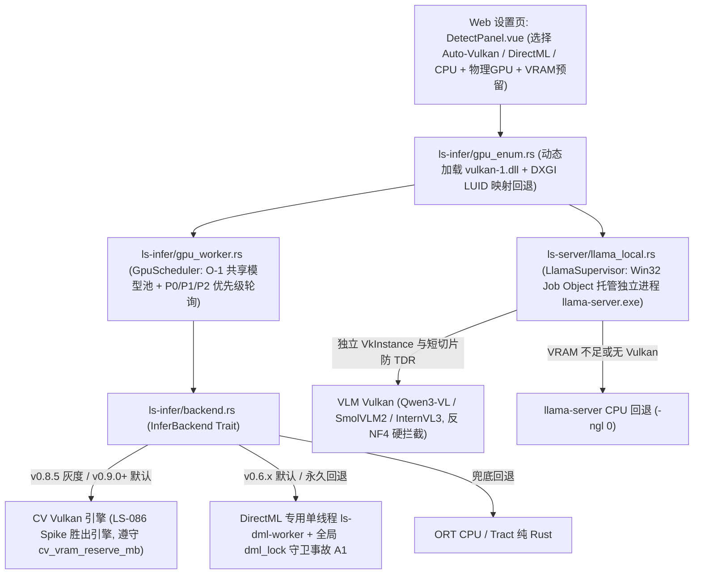

# LabSentinel `v0.6.x → v1.0.0 GA` 总演进规划蓝图（Master Plan）

> **规划基线**：`v0.6.0`（`main @ 2fef1b4`，已完成至 `LS-075`，实码核验 SQLite `SCHEMA_VERSION_LATEST = 22`）
> **状态**：**已审定入库（2026-11-23）**——已同步登记至 `task_plan.md`、`task_registry.md`、`progress.md` 与 `docs/adr/0012-unified-vulkan-gpu.md`（Proposed 草案）。
> **编制口径**：汇总并交叉核验视觉与模型轨（`plan_v1_vision.md`）、AI/VLM/语义检索/MCP 轨（`plan_v1_ai_mcp.md`）、高性能视频/运维/GA 轨（`plan_v1_perf_ops.md`），经 `v0.6.0` 真实 Rust/Vue/SQLite/Inno 源码抽检，已完成全量去重、接口对齐、单调版本号与 `LS-080`～`LS-101` 任务编号统一编排。
>
> `LS-076` 的缺陷与验收见 §1.3。`v0.8.5` 已生成本地双产物。后续推进安排见 §7。GitHub Release 暂停。

---

## 0. 不可违背的架构红线与设计决策

### 0.1 明确纳入的核心必选项（Must-Haves）
1. **Rust-first + Vue 3 单二进制**：所有在线推理、视频采集、规则、VLM 调度、语义检索、MCP 与服务管理均落在 `engine-rs/`（`labsentinel-server.exe`）+ `web/`；`tools/` 与 `scripts/` 永久仅作离线开发/训练/评测/打包支具，不进发行包；严守 `engine-rs/Cargo.toml` 的 `workspace.lints.rust.unsafe_code = "deny"`（必要动态库/C 扩展 FFI 须单文件收口并附 FFI 清单）。
2. **统一 Vulkan GPU 跨厂商路线（CV + VLM，含正式 ADR 修订计划）**：
   - **过渡期（`v0.6.1` ～ `v0.8.0`）**：CV 保持 `DirectML → CPU` 稳定运行，且**永久严守事故 A1 铁律**（DirectML 建会话/`Session::run`/`Drop` 全部收口于专用单 OS 线程 `ls-dml-worker` + 全局 `dml_lock()` + `with_memory_pattern(false)` + `with_parallel_execution(false)`）；`v0.8.0` 率先以原生 **Vulkan** 托管离线 VLM（`llama-server.exe`）。
   - **选型与切换（`v0.7.0` Spike → `v0.8.5` 灰度 → `v0.9.0` 默认）**：在 `ls-infer` 建立插件化 `InferBackend` 抽象，经真机 **Vulkan CV Spike**（`ncnn-vulkan` vs `ort-webgpu/Dawn` vs `wgpu/Burn`）用客观实测锁定胜出引擎并形成 **`docs/adr/0012-unified-vulkan-gpu.md`**（计划修订 `0009-alignment-vs-gpu-and-model-provenance.md` 与 `AGENTS.md` GPU 条款）；`v0.8.5` 开放 `Auto(Vulkan)` 灰度验证，`v0.9.0` 正式将 **Vulkan** 晋升为 **CV + VLM 统一默认跨厂商 GPU 后端**，并**永久保留 `DirectML (dml_lock) → CPU` 自动降级回退链**。
   - **CV + VLM 显存协同**：双方共用统一 Vulkan 物理设备拓扑与显存预留预算，支持同卡分预算或双卡分流（如核显跑 CV + 独显跑 VLM），防 OOM 与 Windows WDDM TDR 驱动重置。
3. **可选托管离线 Vulkan VLM（`llama-server.exe`）**。复用 `ChildGuard`（Win32 Job Object）托管，权重由 Web 设置页按需下载。保留 NF4/Q2/Q3 导入限制。获准导入的具体模型、量化和视觉投影组合仍须通过本项目的精度、延迟与显存对照。量化风险参考 [自动驾驶 VLM 研究](https://arxiv.org/abs/2603.28888)。
4. **细粒度可配权限本地 MCP Server**：Streamable HTTP + JSON-RPC 2.0；**默认关闭**；开启后**默认严格全只读**（11 项 Tier-1 只读工具）；Web 设置页「MCP 接入」提供 **9 项 Tier-2 高权限工具逐项独立勾选授权**（含风险分级、高危二次确认与“一键恢复只读”）；Tier-3 高危/提权/人脸 PII 永禁；独立 `mcp_tokens`（拒浏览器 Cookie CSRF）、默认仅回环、严检 Host/Origin、全量审计落库 `audit_log.detail`、并附 HMAC-SHA256 可验证证据凭证 `_receipt`。
5. **弹性小版本节奏与 Windows 双产物体验**：按 `v0.6.1 → v0.6.2 → v0.7.0 → v0.7.5 → v0.8.0 → v0.8.5 → v0.9.0 → v0.9.5 → v1.0.0 GA` 渐进交付；网页内热配置零手改文件；保持 `zip` + Inno Setup 7 `setup.exe` 双产物、干净卸载且默认保留用户数据；正式发布资产走 CI `release.yml`。

### 0.2 明确排除项（Hard Exclusions）
- **绝不做 PDCA 隐患整改工单闭环**：不建 `hazards` / 整改派单 / 整改前后照销号 / 门牌巡检表流程（合规输出聚焦纯视觉/事件审计、热力图、交接备注与防篡改审计证据包 ZIP）。
- **绝不回归 Python 产品运行时**，**不做 Docker / VM / Flutter / Tauri / 安卓 / CUDA**。
- **非商业/学术数据集政策（2026-11-24 变更）**：项目定位为非商业自用与学习研究，**允许 `SH17`（CC BY-NC-SA）、`FASDD`、`URFD/Le2i` 等非商业/学术数据集参与训练、评测及随包权重发布**；工具链保留来源与许可证自动台账登记（不再做 `exit 2` 硬拦截），随包发布时须在 `NOTICE` 中如实声明对应数据集出处与原许可条款。
- **绝不以 DETR/Transformer 作为 DirectML/Vulkan 默认随包主检测器**（规避 Int64/动态图算子坑），也不让 VLM 替代确定性本地引擎做主实时检测或无人值守自动控制。

---

## 1. `v0.6.0` 基线实码核验与跨轨冲突消解清单

### 1.1 实码抽检核验结果（基准：`main @ 2fef1b4`）
经对照 `engine-rs/`、`web/`、`tools/`、`deploy/`、`docs/adr/` 真实源码，确认当前 `v0.6.0`（`LS-075`）状态与核心短板：
- **存储与依赖核验**：`ls-store/src/lib.rs:17` 确认 `SCHEMA_VERSION_LATEST = 22`；`rusqlite = "0.41" (bundled)`、`ort = "2.0.0-rc.15" (load-dynamic, directml, half)`、`image = "0.25.10"`、`windows-sys = "0.61"`（`ls-server`）；`ls-store/src/operations.rs` 已内置 `photo_check_images`、`alert_delivery_history`、`event_notes`、`camera_outages`、`compliance_daily`；`audit_log` 表已含 `detail TEXT` 列但尚未被读写方法激活。
- **视觉与精度短板（核验确认）**：`worker.rs:596,651` 随包 `yolo11n_ppe.onnx` 硬关闭灰度 CLAHE 且阈值 `(0.50, 0.40)`；`ppe.rs:362-412` 远景裁剪仍复跑原整图检测器、`labcoat-confirm.onnx` 仅读 class 0 未对比负类且无 256×256 上身二分类复检；`boxes_overlap` 缺 `coverage >= 0.60 & margin >= 0.15` 唯一归属；`ByteTrack` 缺遮挡断轨；`detector.rs` 丢弃同次 COCO 前向的 `cup/bottle/wine_glass/cell_phone`；视频/图片双路径硬编码脚底中点入区。
- **VLM 与控制面短板（核验确认）**：`handlers/events.rs:74-93` 的 `event_json()` 只读取 `vlm_verdict`，忽略后台复核写入的 `ai_review`，导致事件展示和筛选缺失。`detect.vlm_prompt` 仅在 `detect_test` 生效，生产三条链路硬编码默认提示词。`cascade_is_negative()` 无法抑制“画面有人但已穿实验服”的误报。`router.rs` 缺单路停流 `POST /api/cameras/:id/stop` 与单规则启停 `PATCH /api/rules/:rid/enabled`。
- **性能与运维短板（核验确认）**：每路独立持有 ORT Session 造成 $O(N)$ 显存占用与 `dml_lock()` 争抢；前端未呈现 `performance.rs` 已采集的 10 维耗时；`Wall.vue` 缺全局并发流硬上限与 WS `?since=` 断线重放；`ls-jobs/src/lib.rs:549` `alert_image()` 硬校 JPEG 魔数 `0xff 0xd8`（切 WebP 必须兼容）；`worker.rs` 每次事件直接 `thread::spawn` 且非事务 Outbox；`deploy/windows/installer.iss:232` 仍引用未随包的 `tools\winsw.exe`；`NOTICE` 存在 ORT 版本（`1.24.4` vs 实装 `1.20.1`）漂移。

### 1.2 三轨整合中已消解的 6 项交叉冲突
| 冲突项 | 原三轨差异 | 本总计划统一裁决 |
|---|---|---|
| **1. Vulkan CV 晋升默认时机** | Perf-Ops 原表在 `v0.7.0` 提前写 Vulkan 默认；Vision 将 Spike 置 `v0.7.0`、引擎落地置 `v0.8.5`、晋升默认置 `v0.9.0` | 采纳渐进零风险链：`v0.6.1` 建 `InferBackend` 抽象 → `v0.6.2` 落地 Vulkan 物理设备枚举与共享 `GpuScheduler`（仍默认 DirectML）→ `v0.7.0` 真机 Vulkan CV Spike → `v0.8.0` Vulkan VLM → `v0.8.5` Vulkan CV 引擎灰度 → **`v0.9.0` 正式晋升统一 Vulkan 默认 GPU** |
| **2. 配置键命名分叉** | `runtime.ep` vs `runtime.backend`；`runtime.gpu_index` vs `runtime.gpu_id`；`cv_vram_budget_mb` vs `vram_budget_mb` vs `cv_vram_reserve_mb` | 全仓统一标准键：**`runtime.backend`**（`auto_vulkan\|vulkan\|dml\|cpu`，向下兼容读取旧 `runtime.ep`）、**`runtime.gpu_id`**（`auto` 或 LUID/`vulkan:<n>`）、**`runtime.cv_vram_reserve_mb`**（默认 `1024`）、**`llama.vulkan_device`**（`auto` 或 `gpu_id`）、**`llama.vram_budget_mb`**（`0`=自动按余量减 CV 预留计算） |
| **3. `events.snapshot_sha256` 重复迁移** | Perf-Ops (`v0.6.2`/`v0.8.0`) 与 AI-MCP (`v0.7.5`) 均声明增列 | 单一归属 **`v0.6.2`（`LS-083`，Schema `v24`）**随干净 WebP 落盘一并写入；后续 VLM、溯源与 MCP `_receipt` 直接复用 |
| **4. 抑制审计与可解释面板重叠** | Vision (`v0.6.2`) 建 `/api/audit/suppressions`；Perf-Ops (`v0.7.0`) 建 `/api/review/suppressions` 与 `/api/events/:eid/explain` | 统一唯一端点：**`GET /api/review/suppressions`**（`LS-082` 建表与写入）、**`GET /api/events/:eid/explain`**（`LS-085` 建抽屉解释面板，`LS-088` 补 VLM 推理链，`LS-091` 补溯源指纹） |
| **5. 既有历史任务衔接** | `task_registry.md` 存在 `LS-062..065`（Windows 4551 阻塞）、`LS-067/068/070`（v0.6.0 现场暂停）、`LS-900`（签名阻塞） | 新路线图任务严格从 **`LS-080`** 顺序起编至 **`LS-101`**；`LS-070`/`LS-067`/`LS-068` 决定 `v0.6.0` 收口；`LS-062..065` 真机联测项并入 `v0.6.2`/`v0.7.0`/`LS-100` 门禁；`LS-900` 在 `LS-101` 闭环 |
| **6. ADR 文件命名规范** | Vision 草案写作 `docs/adr/ADR-0012-...`；仓库实测命名规范为 `0009-...`、`0010-...`、`0011-...` | 统一采用仓库规范文件名 **`docs/adr/0012-unified-vulkan-gpu.md`** |

### 1.3 `LS-076` 缺陷与发布验收

基线为 `2fef1b4` 和本地 `v0.6.0` 产物。复现采用回环地址、临时数据库、CPU 推理和项目验收素材。源码定位和实测结果见 [findings.md](../../findings.md#ls-076-v060-基线缺陷审查)。

| 缺陷 | 当前影响 | 修复归属 | 发布前通过条件 |
|---|---|---|---|
| `LS-076-01` · P0 照片告警规则 | 人数告警忽略区域、时间和规则等级。实验服分支只要区内出现未穿判定就能发告警。 | `v0.6.1` · `LS-080` | 用相同输入对照照片、视频和实时分析。无有效规则时，照片和视频仍留检查记录，告警为零。分别验证停用、限定区域内外和排班内外，命中时核对适用规则、区域、等级和截图。 |
| `LS-076-02` · P0 运行中规则失效 | 已运行来源继续使用启动时的区域和规则。新增可能漏报，删除后可能继续报。 | `v0.6.1` · `LS-081` | 已运行的照片目录、实时流和视频分析，在保存、删除或应用模板后采用生效设置。覆盖区域顶点、排班和包含停用规则的模板，并核对页面显示的生效状态。 |
| `LS-076-03` · P0 推理失败显示检查完成 | 解码成功后，人员推理失败被当成零检测，整段失败仍可标为完成。 | `v0.6.1` · `LS-080` | 验收真无人、正常识别、部分帧失败和全帧失败。统计实际推理成功与失败次数，失败留痕并解释原因，零成功帧不得标为检查完成。实时推理持续失败要有明确状态。 |
| `LS-076-04` · P0 PPE 状态与实际不符 | 自定义模型路径失效时，状态仍显示随包 PPE 已启用，分析只运行人员检测。 | `v0.6.1` · `LS-080` | 检测与状态接口采用同一模型选择逻辑。覆盖自定义文件丢失、类名缺失、加载失败与主动禁用。可用随包模型接管时验证真实输出，降级时标明原因和实际能力。 |
| `LS-076-05` · P0 告警投递中断丢失 | 已创建投递记录的 `pending` 状态被重试遗漏。事件写入和建投递记录之间也存在崩溃窗口。 | `v0.6.1` · `LS-081` 恢复陈旧投递。 `v0.9.0` · `LS-097` 补齐事务。 | `LS-081` 验证重启后恢复陈旧待发项，保留错误原因，活动投递与已成功投递不会被误重发。`LS-097` 用本地模拟渠道验证事件入库、发送前及回执落库前中断的恢复结果，记录渠道支持的幂等边界。 |
| `LS-076-06` · P1 检查留痕污染处置统计 | 首页把普通检查算成待处置，报表又把这些检查算成已处置。 | `v0.6.1` · `LS-081` | 一组混合普通检查、待处置和已处置告警的固定样本，首页待处置数与链接列表一致，报表处置数和误报率使用明确的告警口径。正常检查可查询并保留证据。 |
| `LS-076-07` · P1 已保存的 AI 复核不可见 | 后台复核记录落库，事件列表仍显示未复核，筛选遗漏，报表复核小计固定为零。 | `v0.6.1` · `LS-081` 接通既有结果。 `v0.7.5` · `LS-088` 统一复核引擎。 | 有历史 AI 结果的事件在列表、详情、筛选和报表中一致可见。核对旧字段、级联字段及两者并存时的口径，并保留人工处置状态。 |
| `LS-076-08` · P0 人员权重发布校验缺口 | 准备脚本将任意与原版哈希不符的现有文件视作已转换，严格打包也略过该模型锁的校验。 | `v0.6.1` · `LS-081`。 `LS-101` 沿用门禁。 | 已有缓存、干净构建、ZIP 解包和安装目录都对照转换后哈希与大小。错误、过期或缺失文件阻断发布。独立验证正常无人、可见人员、规则告警及推理失败留痕。 |
| `LS-076-09` · P1 安装器展示无效服务选项 | 管理员安装可选 Windows 服务，当前发行暂存目录及便携 ZIP 均无所需 WinSW。 | `v0.6.1` · `LS-081` 收口安装选项。 `v0.9.5` · `LS-099` 交付原生服务。 | 在干净 Windows 环境验证安装器展示的每个可选运行方式。原生服务交付后验证注册、重启、升级及卸载。 |

`LS-080` 与 `LS-081` 先建立上述回归，再以检测和告警结果可信的版本对照候选权重与性能。验收中的同一段视频应分别覆盖有规则产生告警和无规则只留检查记录，并能打开检查和告警证据。ZIP 与安装版使用同一组发布验收用例。已复现的基础故障计入 `v0.6.1` 发布门禁，后续任务继续复跑。现场相机联测、DirectML 长稳与安装交互纳入对应阶段验收。

---

## 2. 统一版本阶梯与 `LS-080` ～ `LS-101` 总任务表

```mermaid
flowchart LR
    V060["v0.6.0 基线 (LS-075 / DB v22)"] --> V061["v0.6.1: LS-080..081 基线修复、精度与流控"]
    V061 --> V062["v0.6.2: LS-082..083 空间防误报与共享GPU/WebP/PTZ"]
    V062 --> V070["v0.7.0: LS-084..086 片段消警与Vulkan CV Spike"]
    V070 --> V075["v0.7.5: LS-087..088 实验室专项规则与VLM 2.0"]
    V075 --> V080["v0.8.0 · LS-089..092<br/>镜头健康、事件溯源、离线复核"]
    V080 --> V085["v0.8.5 · LS-093..094<br/>Vulkan CV 灰度、场景模板预览"]
    V085 --> V090["v0.9.0 · LS-095..097<br/>GPU 晋升、录像回放、告警回执"]
    V090 --> V095["v0.9.5 · LS-098..099<br/>MCP 授权、审计导出、声光报警"]
    V095 --> V100["v1.0.0 GA · LS-100..101<br/>多路与故障恢复回归、签名发布"]
```

### 2.1 全周期统一任务总表（22 项，零编号冲突）

`LS-080`、`LS-081` 首批交付包含 [基线缺陷验收](#13-ls-076-缺陷与发布验收)。`LS-088`、`LS-097`、`LS-099` 承接对应的长期修复。

| 版本 | Task-ID | 优先级 | 归属主轨 | 任务名称 | 核心交付摘要 | 前置依赖 | DB Schema |
|---|---|---|---|---|---|---|---|
| **`v0.6.1`** | **`LS-080`** | P0 | Vision | `InferBackend` 抽象 + **现成权重对照整合** + 两阶段裁剪 PPE 精判/归属/断轨/COCO 互证 | `ls-infer` 建立 `InferBackend` trait (`Vulkan\|DirectML\|CPU\|Tract`)；**先零训练验证现成权重**：补齐随包 YOLOE 正负对照提示词、导出并对照 Apache-2.0 `PP-LCNet` 多属性/现成合规 PPE 权重；落地 256×256 上身裁剪二分类/多属性器 + 长衣上身双窗复检；`coverage>=0.60 & margin>=0.15`；`IoU>=0.35` 遮挡断轨；零开销复用 COCO `cup/bottle/wine_glass/cell_phone`；修复随包模型禁用 CLAHE | `v0.6.0` | `v22`（无变更） |
| **`v0.6.1`** | **`LS-081`** | P0 | Perf/Ops | 并发流硬上限（≤5）+ WS `?since=` 断线重放 + 耗时 HUD + 敏感度预设 | `streamPool.js` 全局 `IntersectionObserver` ≤5 并发流租约与省流快照降级；`/ws/events?since=` 无缝重放；`LatencyHudBar.vue` 展示分阶段耗时与帧龄；网页「保守/平衡/敏感」三档敏感度一键联动预设 | `v0.6.0` | `v22`（无变更） |
| **`v0.6.2`** | **`LS-082`** | P0 | Vision | 空间智能与防误报治理（多锚点 / 死区 / 双层遮罩 / 记住误报点 / 抑制审计） | 4 种入区锚点（含俯拍 `UpperBody`/`FourPointAny`）、边界死区 `margin_px`、12 帧离场宽限；严格分离 Motion Mask（推理前）与 Object Filter Mask（推理后）；静止目标降频；一键记住常驻误报点（生命安全事件永禁屏蔽）；`suppression_audit` 落库与 `GET /api/review/suppressions` | `LS-080` | **`v23`** |
| **`v0.6.2`** | **`LS-083`** | P0 | Perf/Ops | 共享 `GpuScheduler` + Vulkan 物理设备枚举 + 干净 WebP 叠框 + Debug/Digital PTZ | $O(1)$ 全局共享模型池 + 三级优先级单共享 GPU Worker（DirectML 绑专用单 OS 线程 `ls-dml-worker` + `dml_lock()`）；动态加载 `vulkan-1.dll` 枚举独显/核显与 `VK_EXT_memory_budget`（DXGI LUID 映射回退）及 Web 后端/显卡配置 UI；干净 WebP 快照 + 纯 Rust 内存缩略图 + 告警附图转码兼容 + `SnapshotOverlay.vue` 矢量叠框；实时 Debug 叠层 + 纯前端 1×–5× Digital PTZ + 小地图 HUD | `LS-080`, `LS-081` | **`v24`** |
| **`v0.7.0`** | **`LS-084`** | P0 | Vision | 违规事件段聚合、两级宽限倒计时与合规恢复自动消警（`alert_resolved`） | `EpisodeTracker` 连续违规合并为单条事件段（`first_ts`/`last_ts`/`duration_s`/`hit_count`/峰值截图刷新）；在区每 2s 持续重检 PPE；`70% warning → 超时 alert` 两级宽限升级；穿戴/离场连续恢复触发 `alert_resolved` 自动闭合 | `LS-082`, `LS-083` | **`v25`** |
| **`v0.7.0`** | **`LS-085`** | P1 | Perf/Ops | 统一 AI Review 可解释性抽屉与抑制审视面板 | `GET /api/events/:eid/explain` 聚合本地视觉分数/归属边距/区域锚点/片段信息（后续版本无缝挂接 VLM 推理链与溯源哈希）；前端「抑制审视」滚动查看 `remembered_spot`/`filter_mask`/`stationary`/`grace_recovered` 抑制原因并支持一键入标注池 | `LS-082`, `LS-084` | `v25`（无变更） |
| **`v0.7.0`** | **`LS-086`** | P0 | Vision + Perf/Ops | **统一 Vulkan CV 引擎选型 Spike & 真机基准对比** | 独立实验特性 `vulkan-spike` 在真实 AMD（Radeon 880M）/NVIDIA/Intel 显卡上实测对比 `ncnn-vulkan`（`libloading` + `pnnx`，BSD-3）vs `ort-webgpu/Dawn` vs `wgpu/Burn`，覆盖数值等价度、4 路并发吞吐与 4h 并发 VLM 零 TDR，产出 **`docs/adr/0012-unified-vulkan-gpu.md`** 锁定胜出引擎 | `LS-080`, `LS-083` | `v25`（无变更） |
| **`v0.7.5`** | **`LS-087`** | P1 | Vision | 实验室专项规则（1D `ref_lines` / OR-of-ANDs PPE 矩阵 / 协议无关湿实验规则） | 通风橱探身（按人高归一化 `d/person_h > 0.30`）与拉门过高基准线；按机位/区域 OR-of-ANDs 合规 PPE 组合矩阵（2s/3 帧连续合规，消费随包 10 类中的手套/护目镜）；固定机位规则 `INCUBATOR_DOOR_OPEN` / `SPILL_OR_LEAK` / `GLOVE_CONTAMINATION`；告警扩展 `error_code`/`severity`/`confidence_stage`/`suggestion_tts`（≤25 字） | `LS-084` | **`v26`**（与 `LS-088` 合并） |
| **`v0.7.5`** | **`LS-088`** | P0 | AI/MCP | 统一 VLM 复核、带图报告与持久化问答 | 人员门控、SHA-256 证据去重、关键帧采样和按人送审窗口。AI 安全助手先查 SQLite 再按问题附图，首轮最多 4 张原图，同一证据范围的追问用 `record_only`。费用与调用量按实测记录。 | `LS-083`, `LS-085` | **`v26`**（与 `LS-087` 合并） |
| **`v0.8.0`** | **`LS-089`** | P1 | Vision | 姿态跌倒/昏迷检测 + 可选红外热成像遥测钩子 | 基于 COCO Keypoints（CC-BY-4.0）的 `PoseModel` 四因子几何+静止时长状态机（可结合 `URFD/Le2i` 等学术跌倒集调参/评测，可选异步 VLM 复核拉升遮挡召回至 ≥90%）；`POST /api/telemetry/thermal` + MQTT 订阅接入 MI48/MLX90640 低分辨红外热成像，`>55°C` 或温升超限 0.3s 超前火灾预警 | `LS-087`, `LS-088` | **`v27`**（与 `LS-091` 合并） |
| **`v0.8.0`** | **`LS-090`** | P1 | Perf/Ops | 摄像头防篡改检测（`tamper.rs`）+ 可选 FFmpeg 音频尖峰旁路 | `160×90` 灰度统计检遮挡/黑屏、强光致盲、无人慢速 EMA+Sobel NCC 视角移位（抗 IR-cut 昼夜切换误报）及自动恢复闭合；可选单路 8kHz PCM RMS 音频尖峰（玻璃碎裂/通风橱蜂鸣）抓拍存证 | `LS-083` | `v27`（无新表） |
| **`v0.8.0`** | **`LS-091`** | P1 | Perf/Ops | SHA-256 溯源、PPE 诊断与热力图 | `provenance_snapshots` 固化模型、后端、阈值、规则与提示词版本。补足逐人 PPE 诊断，显示整图、归属、裁剪和末级复核分别用了什么证据，以及未知的原因。报表热力图可直达对应机位和时间筛选。 | `LS-083`, `LS-088` | **`v27`**（与 `LS-089` 合并） |
| **`v0.8.0`** | **`LS-092`** | P0 | AI/MCP | 可选离线 Vulkan `llama-server.exe` 与 GGUF 校验 | 托管回环进程，按需引导下载，按 GPU 预算和单并发限制复核。校验模型与视觉投影版本、GGUF 量化和图像输入。先实测实验室图像上的识别、响应延迟和峰值显存，再决定可用档案。微调配方留作后续选项。 | `LS-083`, `LS-088` | `v27`（配置落 `app_settings`） |
| **`v0.8.5`** | **`LS-093`** | P0 | Vision + Perf/Ops | **Vulkan CV 灰度**与**人员、PPE 候选对照** | 利用 `v0.8.0` 的逐人诊断和固定评测集，先在当前 CPU/DirectML 评估 YOLO26n 与有匹配标签的 PPE 权重。独立验证 `LS-086` 的 Vulkan 候选和跨厂商长稳，再用同一权重核对 Vulkan、DirectML 和 CPU 的结果及自动回退。 | `LS-086`, `LS-091`, `LS-092` | `v28`（无变更） |
| **`v0.8.5`** | **`LS-094`** | P1 | AI/MCP | 声明式「实验室安全技能包（Skill Packs）」4 套内置场景模板 | 内置 4 套场景包（`wet_chem` / `biosafety` / `optical_laser` / `after_hours_unattended`），统一编排区域蓝图、规则排班、PPE 策略矩阵、VERA SOP 清单、YOLOE 词汇与告警语义；提供 Diff 预览、事务套用、热重载与自定义导出（**零 PDCA 工单**） | `LS-087`, `LS-088`, `LS-089`, `LS-090` | **`v28`** |
| **`v0.9.0`** | **`LS-095`** | P0 | Vision | **Vulkan 默认晋升门槛**与数据集版本化 | `LS-093` 真机灰度通过后切换 `auto_vulkan`。逐项核验公开素材许可及标签，按来源和用途分集；按数据集选择导出，对账导出文件与勾选清理的样本。记录模型输入、类别、阈值与结果，按真实机位和低光分组比较。 | `LS-093` | **`v29`** |
| **`v0.9.0`** | **`LS-096`** | P1 | AI/MCP | 零外部服务中英文语义事件检索（`sqlite-vec` + `Jina-CLIP v2`/`SigLIP 2`） | `ls-store/src/vec.rs` 单点 FFI 静态嵌入纯 C `sqlite-vec`；`ls-infer/src/embed.rs` 按需加载双语 ONNX 编码器（Matryoshka 256/512 维，默认后台 **CPU EP 零抢实时 GPU**）；实时入队+后台低频回填；Vue `ExploreGrid.vue` 支持自然语言搜图与“找视觉相似”并严格继承设备机位权限 | `LS-083`, `LS-093` | **`v30`** |
| **`v0.9.0`** | **`LS-097`** | P0 | Perf/Ops | 零转码录像、事件回放、告警投递恢复 | 可选 `retina` RTSP 与 FFmpeg 回退。`ls-media` 保存原始编码分段并按需封装 fMP4。事件详情可回看前后证据，按连续、运动、告警分层留存。用 SQLite 事务与有界投递队列实现可恢复的告警回执。各环节按 §2.2 验收。 | `LS-083`, `LS-091` | **`v31`** |
| **`v0.9.5`** | **`LS-098`** | P0 | AI/MCP | 细粒度可配权限本地 MCP Server（默认只读 + 逐工具高权限勾选 + 审计与凭证） | 前置补齐 `POST /api/cameras/:id/stop` 与 `PATCH /api/rules/:rid/enabled`；实现 MCP Streamable HTTP + JSON-RPC 2.0（`/mcp` 默认 OFF→开启默认仅 11 项 Tier-1 只读工具；Web `McpSettings.vue` 逐项勾选 9 项 Tier-2 高权限工具 + 高危确认 + 一键恢复只读；Tier-3 与人脸 PII 永禁）；独立 `mcp_tokens`（拒 Cookie CSRF）、默认仅回环、严检 Host/Origin；激活 `audit_log.detail` 全量读写拦截留痕；所有事件/变更返回 HMAC-SHA256 可验证 `_receipt` | `LS-088`, `LS-091`, `LS-096` | **`v32`** |
| **`v0.9.5`** | **`LS-099`** | P1 | Perf/Ops | 原生 `windows-service` 服务化 + 一键审计证据包 ZIP + 可选物理声光报警 Actor | `windows-service` 原生 SCM 服务（`--service-run/install/uninstall/status` + Session 0 护栏），彻底移除 `installer.iss` 中无效 WinSW；`GET /api/export/audit-pack.zip` 流式导出离线自包含纯视觉/事件审计包（HTML+CSV+JSON+媒体+`manifest.sha256`，**零 PDCA**）；可选单线程优先级仲裁 `ActuatorActor`（USB-RS485 Modbus RTU / HTTP 继电器，防竞态） | `LS-091`, `LS-097` | `v32`（无新表） |
| **`v1.0.0`** | **`LS-100`** | P0 | All Tracks | **72 小时长稳、识别准确度与权限验收** | 4/9 路 1080p@5fps 运行 Vulkan CV 和离线 VLM，覆盖 AMD 核显与 NVIDIA/Intel 独显。DirectML 回退跑 12 小时。使用独立的逐人 PPE、画面级 VLM 与时序姿态基准。验证 MCP 权限矩阵与 `LS-064/065` 性能门槛。 | `LS-095` ～ `LS-099` | `v32`（冻结） |
| **`v1.0.0`** | **`LS-101`** | P0 | Perf/Ops | 升级/回滚/干净卸载全矩阵 + 代码签名（`LS-900`）+ `v1.0.0` GA 双产物正式发布 | `v0.5.0/v0.6.0/v0.9.5 → v1.0.0` 覆盖升级、一键回滚、保数据/全清卸载双路径（含 SCM 服务）真机实测；CI 接入 Authenticode 代码签名关闭 `LS-900`；修正 `NOTICE`（含 ORT 版本漂移）与 `assets.lock.json`；全仓门禁绿灯并经 CI `release.yml` 发布 `zip` + `setup.exe` | `LS-100` | `v32`（冻结） |

### 2.2 同类项目的工程做法与验收

`v0.7.5` 已有可见区域预览、单页五路实时流上限、快照降级、事件断线补发、实时最新帧缓冲和合规恢复记录。后续按下表扩充这些入口和验收。[代码与参考来源](model-source-review-2026-11-24.md#对其他项目的取用范围)

| 版本与任务 | 安排 | 通过条件 |
|---|---|---|
| `v0.8.0` · `LS-090` | **机位健康状态**。摄像头列表与值守大屏区分断流、旧画面、遮挡、夜视切换和稳定恢复。对异常记首次发生、持续时间、最后有效帧与恢复原因，复用已有离线与恢复事件。声音尖峰仅供选配的时间点定位。 | 用静态空房、昼夜切换、冻结源、短断流和持续断流对照。同一次持续异常与同一次恢复各记一次。快照显示实际采集时间，旧画面可辨认。无音轨的机位正常工作。 [Frigate 预览](https://docs.frigate.video/configuration/live/) |
| `v0.8.0` · `LS-091/092` | **从事件追溯当时的证据与决定**。保留干净原图和独立叠层，记录当时生效的机位、区域、规则版本和抑制原因。复核繁忙或失败时显示待复核、超时、跳过等结果。 | 录入同一机位的普通检查、被抑制事件和正式告警，再改规则。历史详情保留各自的原图、判定及配置版本。复核服务慢或不可用时，本地及协作档案的检测、检查留痕、告警和恢复继续。用少量回环请求验收。 [visionguard](https://github.com/Viral3899/visionguard) · [VLM-Guard](https://github.com/Seeed-Projects/VLM-Guard) |
| `v0.8.5` · `LS-094` | **场景模板先预览再套用**。复用现有规则模板与热生效入口，按机位展示区域、排班、穿戴组合、变更与冲突。现场自定义规则由值守人员明确选择是否替换。 | 重复套用不会重复新增。目标变更后旧预览失效。未绑定机位区域时指出缺项。任一选定机位校验失败时整次应用回滚。保存后能核对实际生效的规则。 [DeepCamera](https://github.com/SharpAI/DeepCamera) · [SafeLABS](https://github.com/Thithira-Paranawithana/SafeLABS) |
| `v0.9.0` · `LS-097` | **录像、分析和预览分别验收**。沿用实时最新帧与离线顺序抽帧。大华和乐橙先核对主辅码流、首帧、编码和重连。事件详情可打开前后短片，片段保留关联时间和机位。存储达到配额时优先清理到期普通录像，保留事件证据的配额。 | 大屏关闭后分析和录像仍继续。浏览器回看不阻塞本地检测。对照时间戳跳变、断流、冷启动和磁盘配额，事件显示实际录像范围，缺段或到期时给出原因并可看留存截图。录像片段独立对照 H.264/H.265 及 FFmpeg 回退。 [Moonfire NVR](https://github.com/scottlamb/moonfire-nvr) · [Frigate 录像留存](https://docs.frigate.video/configuration/record/) · [Retina](https://github.com/scottlamb/retina) |
| `v0.9.0` · `LS-097` | **告警记录带投递结果**。同一事件与待投递记录同步落库。界面按渠道展示待发送、重试、渠道已接收及待核实。恢复事件关联原事件，便于交班回看。 | 模拟发送前退出、渠道已接收但回执未保存、重启恢复。已确认回执的记录不会重复发，未确认的按渠道能力用同一投递标识核对。通知失败时本地事件与证据仍可查。 [Construction-Hazard-Detection](https://github.com/yihong1120/Construction-Hazard-Detection) · [Sentinel_AI](https://github.com/realxpen/Sentinel_AI) |
| `v0.9.5` · `LS-098/099` | **授权约束与独立声光输出**。在各自的角色权限内，MCP 查询、证据链接、搜索和审计导出统一按机位授权。原生服务恢复软件值守后，再按本地确认事件联动可选声光设备。 | 缩小授权或吊销后，下一次查询和媒体请求即采用新权限。受控模拟中验证高等级告警优先、合规恢复后复位、硬件离线状态可见及重连后同步。硬件离线时软件告警正常记录和投递。 [VLM-Guard](https://github.com/Seeed-Projects/VLM-Guard) |
| `v1.0.0` · `LS-100/101` | **集中跑故障恢复回归**。在现有 4 路和 9 路长稳测试中加入录像回看、多终端值守、短断流、慢复核、录像配额和进程重启。 | 对账逐路有效帧率、帧龄、断流缺段、事件顺序、投递回执和大屏流数量。相同验收样本分别用于 ZIP 与安装版。通过口径见 §6。 [lab-monitor](https://github.com/kelongyan/lab-monitor) |

---

## 3. 核心架构主干与跨模块协同设计

### 3.1 统一 Vulkan GPU 演进与显存协同架构（DirectML → Unified Vulkan）

- **统一配置契约（`app_settings`）**：
  - `runtime.backend`：`auto_vulkan | vulkan | dml | cpu`（`v0.6.1–v0.8.5` 默认 `dml`，`v0.9.0+` 默认 `auto_vulkan`；自动兼容历史 `runtime.ep`）。
  - `runtime.gpu_id`：`auto` 或跨 API 稳定 `luid` / `vulkan:<index>`，经 `gpu_enum.rs` 精确同步至 Vulkan 物理设备索引与 DirectML `device_id`。
  - `runtime.cv_vram_reserve_mb`：默认 `1024` MB，保障多路 CV 模型与中间张量安全水位。
  - `llama.vulkan_device`：`auto` 或独立指定第二张显卡（支持核显跑 CV + 独显跑 VLM 零争抢）。
  - `llama.vram_budget_mb` 的 `0` 表示按可用显存扣除 CV 预留量，换算可放在 GPU 上的层数。以单并发、小批次起步，用实际 GPU 排队、显存与超时记录调整参数。
- **ADR 修订流程**。`LS-086` 保留各厂商实测和 [ADR-0012 草案](../adr/0012-unified-vulkan-gpu.md)。`LS-093` 在同一批权重上比较后端，再单独比较新旧权重。`LS-095` 满足灰度与回退门槛并经用户确认后更新 GPU 默认策略。DirectML 保留 `dml_lock()` 和 CPU 自动回退。

### 3.2 视觉精度与规则引擎四层漏斗（攻克 `LS-075` 52/57 未知率与告警疲劳）
1. **L1 精准检测与两阶段精判（`LS-080`）**：
   - 整图 `yolo11n/yolo26n` 同次前向零开销产出 `person(0)` + COCO 上下文 `bottle(39)/wine_glass(40)/cup(41)/cell_phone(67)`。
   - 整图 PPE 经 `assign_unique_owner`（`coverage >= 0.60` 且次优边距 `margin >= 0.15`）唯一归属，并消费随包 10 类中的 `Gloves`/`Glasses`；`ByteTrack` 在两人重叠 `IoU >= 0.35` 时强制断轨清空脏 PPE 继承。
   - `v0.8.0` 补充整图、唯一归属、上身裁剪与 YOLOE 正负复核的逐人证据。分别记录无命中、多人归属冲突、证据不足和模型错误。先用固定样本定位被末级复核压成未知的阳性，再用白衬衫和浅色外套校准。256×256 二分类和双窗裁剪由 §3.4 的实测决定。
   - COCO `cell_phone` 近口鼻区抑制 `no_mask` 与误判饮水；`cup/bottle` 连续 ≥3 帧近口鼻区确认饮食并推导 `no_mask (BehaviorInference)`。
2. **L2 空间防误报治理（`LS-082`）**：
   - 4 种可选入区锚点（`BottomCenter` / `BodyCenter` / `UpperBody`[俯拍实验台首选] / `FourPointAny`）+ 迟滞边界死区 `margin_px` + `12` 帧离场宽限。
   - 严格区分 **Motion Mask**（推理前屏蔽屏闪/指示灯）与 **Object Filter Mask**（推理后滤除玻璃倒影/走廊）；静止目标自动降频；一键 **Remembered FP Spots** 压制椅背白大褂（硬编码永不屏蔽 `person_fall`、`thermal_overheat`）；所有抑制原因写入 `suppression_audit` 并在 `GET /api/review/suppressions` 透明可查。
3. **L3 片段聚合、专项规则与多模态感知（`LS-084`, `LS-087`, `LS-089`, `LS-090`）**：
   - 违规片段聚合（`duration_s`/`hit_count`/峰值置信度截图更新）+ 两级宽限（`70% warning → 超时 alert`）+ 恢复迟滞自动消警（`alert_resolved`）。
   - 1D 空间基准线 `ref_lines`（通风橱探身按人高归一化 `d/person_h > 0.30`、拉门过高）、按机位 OR-of-ANDs PPE 策略矩阵、固定机位规则（`INCUBATOR_DOOR_OPEN` / `SPILL_OR_LEAK` / `GLOVE_CONTAMINATION`）、COCO-Pose 四因子跌倒状态机（可结合 `URFD/Le2i` 调优与评测）、HTTP/MQTT 红外热成像 `0.3s` 预警、`tamper.rs` 镜头防篡改与可选音频尖峰。
4. **L4 数据飞轮 2.0 与来源台账（`LS-095`）**：
   - 按标签粒度和许可登记数据来源并写入 `NOTICE`。Chemist Eye 作画面级研究对照，逐人标注后可纳入 PPE 归属评测；`SH17`、`FASDD`、`URFD/Le2i` 等非商业/学术集允许纳入训练与随包（仅限非商业自用/学习，须登记原许可）。训练用的数据与现场验收集分开，保留 ONNX（`opset<=21`）和 Vulkan 转换、干净原图难负样本与标注回画抽检。

### 3.3 防幻觉 VLM 2.0、性价比 AI 报告/问答历史、技能包与语义检索（`LS-088`, `LS-092`, `LS-094`, `LS-096`）
- **VLM 送审与证据**。人员复核用人员门控、原始证据 SHA-256 去重和按人限频。以本机已确认身份跨轨迹、机位合并窗口，身份未知时按当前连续轨迹限频。每人窗口内选一张可见证据最清楚的图。同类违规涉及不同人时各自记录与送审。固定机位巡查单独调度。对时序事件单独验证最多三张关键帧是否保留事实，记录真实用量。复核只描述可见证据，输出结构化结果并由代码检查类别、人数与冲突。
- **带识图 AI 辅助报告、多轮历史问答与持久化记录（借鉴 `SaKaNa-hxy/LabSentinel` + `VLM-Guard` 精华）**：
  1. **AI 辅助安全报告（`ai_reports`）**：支持日/周/月/自定义时段一键生成中文安全分析报告——后端先用 SQLite 精确汇总事件数、合规率、高频机位与时段分布，再附最多 4 张代表性干净原图（可选“纯数据脱敏模式”不发图）交性价比 VLM 生成可读解读、风险归因与整改建议，结果持久化归档，支持历史对比与导出 Markdown/PDF。
   2. **带图多轮问答（`ai_chat_sessions`、`ai_chat_messages`）**。Rust 先按授权的机位、时间与事件号查 SQLite。首轮附最多 4 张干净原图（≤1600px WebP），同一证据范围的追问走 `record_only` 并注明来源。问题指向新证据时按新范围重新核查。
  3. **工程可靠性**：远程 LLM HTTP 调用全部放在 SQLite 事务之外执行（防长事务锁库）；会话写入采用 `revision` 乐观并发锁 + `request_id` 幂等防重发；离线/无 API Key 时优雅降级为本地确定性统计摘要。
- **离线 Vulkan VLM**。`LS-092` 先比较小体量 `Qwen3-VL` 与 Chemist Eye 的 LLaVA-Phi3 参照组合，再看 SmolVLM2 或 InternVL3 是否有明确收益。模型、投影、量化和图像模板一起锁定。检查 JSON 正确率、未知率、真违规召回、CPU/GPU 资源和高峰时推理延迟。模型排队或超时时，本地检测、事件留痕和确定性告警继续。
- **4 套声明式安全技能包**：`wet_chem` / `biosafety` / `optical_laser` / `after_hours_unattended`，一键 Diff 预览套用规则、PPE 矩阵、VERA SOP 与 YOLOE 词汇，零 PDCA 流程。
- **嵌入式语义检索**：静态嵌入 `sqlite-vec` + ONNX `Jina-CLIP v2`/`SigLIP 2`（Matryoshka 256/512 维，默认后台 CPU EP 不抢实时 GPU），在 Vue `ExploreGrid.vue` 实现自然语言搜图与“找视觉相似”，严格继承设备机位权限。

### 3.4 现成权重与逐人验证（`LS-091`, `LS-092`, `LS-093`, `LS-095`）

1. **`v0.8.0` 先定位「看不清」的来源**。记录衣服被遮挡、找错人、原始模型漏检、末级复核缺少正证据等情况。带入两张合成广角图和浅色开衫实例。保留原有 59 张图作为历史对照，新增与其来源不同的固定验收集，标注每个人的躯干可见性及已穿、未穿或无法辨认。覆盖远近、昼夜、背影、多人重叠和反光。按机位及录制时段拆分调参与盲测，避免同段视频相邻帧重复。
2. **`v0.8.5` 现成权重先按任务对照**。优先试用已在 `v0.7.5` Rust 照片入口跑通的 YOLO26n ONNX 作为人员检测候选，同时验证杯、瓶、手机等既有辅助类别。白大褂优先寻找有白大褂标签且允许使用的权重。SaKaNa 的上身二分类方法值得参考，公开仓库只有评测与配置。ELYRA 的普通上衣标签已实测会把浅色开衫归作合规上衣，PP-LCNet 的 `LongCoat` 也是通用衣长属性。化学实验室正类模型可验证穿戴证据，未检出时保留未知。离线 VLM 按 §3.3 单独评估。见[候选详情和对照样本](model-source-review-2026-11-24.md)。
3. **通过对照后再启用**。同样的视频、帧率、输入尺寸和后端，记录逐人已穿、未穿、未知，以及错归属、真违规召回和每小时误报。性能记录预处理到规则判定的 P50/P95、单路到多路的积压与显存。候选先在独立实例或后台旁路比较，当前规则和告警照常。模型清单固定来源版本、尺寸、SHA-256、代码与权重和数据各自的许可、类名、预处理和 CPU/DirectML/Vulkan 兼容结果。可选权重和默认权重分别验收，有针对性的负例通过后才扩大启用范围。
4. **`v0.9.0` 完善标注与复用**。按任务分数据集，保留原图、标注来源和机位光照分组。导出前抽检回画，按用户选择导出或清理，核对导出包完整再删除选中的副本。现成权重仍不足时，依次评估上身裁剪、正负标定、干净原图难负样本，随后再考虑遮挡增广、多属性或短输出 LoRA。训练配方记入开发工具。本机执行推理对照和数据检查。

### 3.5 细粒度可配权限本地 MCP Server（`LS-098`）
- **三层权限模型与默认安全态**：
  - **总闸**：`mcp.enabled` 默认关闭（`/mcp` 返 `404`）；开启后默认 `mcp.allowed_write_tools = []`（**严格全只读**）。
  - **Tier 1（11 项默认只读工具）**：`get_system_status`、`list_cameras`（RTSP 密码强制脱敏）、`get_camera_status`、`list_events`、`get_event_evidence`（缩略图需显式开 `mcp.allow_image_content`）、`semantic_search_events`、`get_compliance_stats`、`list_zones_and_rules`、`list_alert_silences`、`list_folder_images`、`list_skill_packs`。
  - **Tier 2（9 项高权限工具，Web `McpSettings.vue` 逐项独立勾选 opt-in）**：`trigger_folder_scan`（低）、`trigger_event_vlm_review`（低-中）、`add_event_note`（低-中）、`triage_event`（中，单次限 1 条必填 `reason`）、`start_camera`（中）、`delete_alert_silence`（中）、**`stop_camera`（高，独立开关+必填原因）**、**`create_alert_silence`（高，默认时长上限 ≤4h，禁 `global` 除非另勾）**、**`toggle_rule`（高，仅启停不可改删）**；高危项勾选需二次确认，页面常驻**「一键恢复严格只读」**按钮。
  - **Tier 3（硬编码永禁）**：服务停机/重启、密码/令牌与 MCP 自身权限修改（防 Prompt Injection 自提权）、删除相机/区域/规则、配置替换导入、密钥读写、插件管理、**人脸生物特征库与名单读写（严格隔离 PII）**、数据库维护与原始备份下载。
- **安全纵深与可验证凭证**：
  - 独立 `mcp_tokens`（仅认 `Authorization: Bearer lsmcp_...`，拒 Cookie CSRF，令牌自带 `read_only | policy` 作用域）；默认仅回环 IP（`127.0.0.1` / `::1`）；严格 `Host` 白名单与拒跨域 `Origin`；独立限流（只读 120/min、高权限 20/min）。
  - 激活 `audit_log.detail` 列：全部高权限调用与拒绝（`-32003`）同步落库；所有事件与变更工具统一返回带 `event_id`、`event_ts`、`snapshot_sha256`、`provenance_hash` 与 `HMAC-SHA256` 签名的 `_receipt`（配 `POST /api/mcp/receipts/verify` 核验）。

---

## 4. 统一 SQLite Schema 演进蓝图（`v22 → v32`）

> **迁移铁律**：所有版本迁移均在 `engine-rs/crates/ls-store/src/lib.rs` 中遵循 **纯增量、向前兼容、幂等执行**（`CREATE TABLE IF NOT EXISTS` + `PRAGMA table_info` 探列增列 + 新增列必有安全默认值 + 绝不删除或修改既有旧列），确保跨版本覆盖升级无损且 `--rollback` 回退旧二进制仍可读取主库。

| Schema 版本 | 引入版本 / Task-ID | 新增表 / 触发器 | 既有表增量列（均含默认值） | 备注与跨轨复用 |
|---|---|---|---|---|
| **`v22`** | `v0.6.0`（现状基线） | 既有全部表（含 `operations.rs` 与 `faces.rs`） | — | 实码核验 `SCHEMA_VERSION_LATEST = 22` |
| **`v23`** | `v0.6.2` · `LS-082` | `camera_masks`（`motion\|object_filter`）、`fp_spots`、`suppression_audit`（含保留清理索引） | `zones`: `anchor_mode TEXT DEFAULT 'bottom_center'`, `margin_px INTEGER DEFAULT 0`, `leave_grace_frames INTEGER DEFAULT 12` | 历史安全区行为 100% 不变 |
| **`v24`** | `v0.6.2` · `LS-083` | — | `events`: `detections_json TEXT`, `snapshot_sha256 TEXT` | 干净 WebP 叠框与统一摘要字段，被 `LS-088`/`091`/`098` 复用 |
| **`v25`** | `v0.7.0` · `LS-084` | `violation_episodes`（活跃/历史片段索引表） | `events`: `episode_id INTEGER`, `first_ts TEXT`, `last_ts TEXT`, `duration_s REAL DEFAULT 0`, `hit_count INTEGER DEFAULT 1`, `peak_conf REAL`, `resolved_ts TEXT`, `alert_tier TEXT DEFAULT 'alert'`；`rules`: `grace_s INTEGER DEFAULT 0`, `warn_ratio REAL DEFAULT 0.70` | 进程重启自动闭合残留活跃片段 |
| **`v26`** | `v0.7.5` · `LS-087` + `LS-088` | `ref_lines`、`camera_ppe_policies`、`camera_vlm_sop`、`ai_chat_sessions`（含 `revision` 乐观锁）、`ai_chat_messages`（含 `request_id` 幂等与 `evidence_mode`）、`ai_reports`（含导出/归档快照） | `events`: `error_code TEXT`, `severity TEXT`, `confidence_stage TEXT`, `suggestion_tts TEXT`, `vlm_prompt_hash TEXT`, `vlm_model TEXT` | 合并 Vision 与 AI 轨同版本迁移，统一承载事件追问、多轮安全问答与 AI 辅助报告历史；同时 `EVENT_COLUMNS` 补读既有 `ai_review*` 三列 |
| **`v27`** | `v0.8.0` · `LS-089` + `LS-091` | `provenance_snapshots`、`event_provenance` | — | 按哈希复用配置摘要。温度门槛使用现有规则字段。 |
| **`v28`** | `v0.8.5` · `LS-094` | `scene_pack_applications` | — | 同事务保存模板版本、预览摘要和应用目标。 |
| **`v29`** | `v0.9.0` · `LS-095` | — | `dataset_samples`: `lighting TEXT DEFAULT 'unknown'`, `is_hard_negative INTEGER DEFAULT 0`, `source_fp_spot_id INTEGER` | 支撑 `val_weak/` 低光集与干净难负样本挖矿 |
| **`v30`** | `v0.9.0` · `LS-096` | `event_embeddings_meta`、虚表 `vec_event_embeddings USING vec0(...)`、`prune_event_embeddings` 触发器 | — | `ls-store/src/vec.rs` 单点 FFI 注册 `sqlite-vec`，随 `events` 删除联动清理 |
| **`v31`** | `v0.9.0` · `LS-097` | `recording_segments`、`recording_gops`、`alert_dedup_state` | `alert_deliveries`: `idempotency_key TEXT`, `next_attempt_ts TEXT`, `receipt_code INTEGER`, `receipt_body TEXT`, `latency_ms INTEGER`, `delivered_ts TEXT`（含唯一部分索引） | 断电安全零转码关键帧索引与事务性 Outbox 回执 |
| **`v32`** | `v0.9.5` · `LS-098` | `mcp_tokens(id, name, token_prefix, token_hash UNIQUE, scope, created_ts, last_used_ts, expires_ts, revoked)` | 激活既有 `audit_log.detail` 列读写 | `v1.0.0 GA` 冻结版本 |

---

## 5. 关键风险矩阵与缓解策略

| 编号 | 风险点 | 严重度 | 触发阶段 | 预防与缓解措施 |
|---|---|---|---|---|
| **R-01** | **DirectML 跨线程并发触发事故 A1（Windows 冻结 / Kernel-Power 41）** | 致命 | `v0.6.1` ～ `v1.0.0`（含回退模式） | `LS-080` 收口全仓唯一 ORT 入口 `ort_session.rs`；`LS-083` 将所有 DirectML 操作绑定至单一专用 OS 线程 `ls-dml-worker` + 全局 `dml_lock()` 双保险；`LS-100` 强制跑 12h DirectML 回退压测。 |
| **R-02** | **Vulkan CV + Vulkan VLM 同卡并发触发 WDDM 2s TDR 或显存 OOM** | 高 | `v0.8.0` ～ `v1.0.0` | `llama-server.exe` 独立进程独立 `VkInstance`，强设 `--parallel 1 --batch-size 256 --ubatch-size 128` 切短单次计算；统一 `runtime.cv_vram_reserve_mb` 动态折算 `-ngl`；不足自动回落 CPU；`LS-086`（4h）与 `LS-100`（72h）强制并发压测。 |
| **R-03** | **Vulkan CV Spike 候选引擎算子/精度/体积不达标** | 高 | `v0.7.0` (`LS-086`) | `LS-086` 在独立 `vulkan-spike` 特性中用真机实测 `ncnn-vulkan` / `ort-webgpu` / `wgpu` 三方案；设置硬性淘汰线（框匹配 ≥98%、4 路并发提速/零锁阻塞、包体增量 ≤15MB）；若极端机型无 Vulkan 驱动，自动降级 `DirectML → CPU` 零报错。 |
| **R-04** | **`w64devkit`（`windows-gnu`）+ 中文路径链接原生 C/C++ 依赖失败** | 高 | `LS-083` (WebP)、`LS-093` (Vulkan)、`LS-096` (`sqlite-vec`)、`LS-099` (串口) | 严守“纯 Rust 或运行时 `libloading` 动态加载 DLL（如 `vulkan-1.dll`、`ncnn.dll`、`onnxruntime.dll`）”优先原则；凡引入 C 编译的 crate（如 `sqlite-vec`）须先在 `CARGO_TARGET_DIR=C:\Users\User\devtools\ls-target` 配方下通过单模块编译链接冒烟。 |
| **R-05** | **量化后的离线 VLM 漏掉真实违规** | 高 | `v0.8.0` (`LS-092`) | 保留 NF4/Q2/Q3 导入限制。锁定实际加载的权重、量化与视觉投影，在本项目同一组实验室样本上比较精度和显存，再决定是否进入下载目录。 |
| **R-06** | **本地 MCP 被 Prompt Injection 致盲监控或窃取生物特征 PII** | 高 | `v0.9.5` (`LS-098`) | 默认关闭、开启默认全只读；高危写工具逐项独立授权（`stop_camera`/`create_alert_silence`/`toggle_rule` 带二次确认与时长硬上限）；MCP 权限配置与人脸库划入 Tier-3 永禁；拒 Cookie CSRF、锁回环、禁跨域 Origin、100% 审计落库。 |
| **R-07** | **数据集与依赖来源台账漂移** | 中 | `v0.8.5` ～ `v1.0.0` | `LS-095` 在 `merge_datasets.py`/`train_ppe.py` 自动记录所用数据集（含 `SH17`/`FASDD`/`URFD` 等非商业/学术集）的出处与原许可清单，不再硬拦截；`LS-101` 刷新 `NOTICE`（含非商业声明与修复 ORT 版本漂移）与 `assets.lock.json`。 |
| **R-08** | **Windows 4551 Code Integrity / SmartScreen 拦截未签名可执行文件** | 中-高 | `v0.6.x` ～ `v1.0.0` | 研发期持续在可运行环境与 CI 跑通端到端验证；`LS-101` 收口 `LS-900`，在 CI `release.yml` 接入正式 Authenticode 签名 + RFC 3161 时间戳并门禁验证 `Status == Valid`。 |

---

## 6. `v1.0.0 GA` 量化退出门禁（Exit Criteria）

发布 `v1.0.0` 正式版须通过以下指标，并在 `progress.md` 记录实测结果。

### 6.1 视觉准确度与规则门禁（`LS-100`）
- **基础链路回归**。照片、视频与实时流重跑 §1.3 的规则热更新、区域和排班、PPE 模型回退、推理失败及事件证据用例。
- **逐人 PPE**。59 张高位照片保留 `LS-075` 的 `52/57` 未知历史基线。固定逐人验收集上，躯干足够可见时未知率 **`≤ 20%`**，已作出明确穿戴判定的准确率 **`≥ 90%`**，已穿白大褂误报未穿 **`= 0`**。同时单列人员漏检、画面无法辨认和真实未穿的召回。正负两类召回的均值目标 **`≥ 92%`**，漏检与输出未知计入该真实类别的未命中。
- **难负例与归属**。在至少 50 个白衬衫、浅色外套等负样本上，误认实验服 **`≤ 5%`**。有逐人归属标注的遮挡场景中，PPE 错配率 **`≤ 5%`**。报告有效人数、各类真实样本数、输出未知数和误报数。
- **画面级 VLM 与跌倒**。Chemist Eye 分别报告作者 400 张和 900 张两套画面级结果。逐人归属只统计补齐人员标注的样本。跌倒用另外的时序片段覆盖跌倒、正常站坐及遮挡，保留召回 **`≥ 90%`**、正常误报 **`≤ 3%`** 两项目标。
- **低光（`val_weak/`）**。固定机位和相近人体尺度下，对照彩色与低光，低光实验服违规召回 **`≥ 78%`**，跌幅 **`≤ 12`** 个百分点。单列夜视下人眼也无法判定的画面。
- **空间与聚合**：俯拍实验台 `UpperBody`/`FourPointAny` 入区召回 **`≥ 95%`**；Remembered FP Spots 抑制率 **`100%`**（生命安全事件 0 屏蔽）；10 分钟连续违规合并为 **`1` 条事件段**，恢复合规后 **`≤ 3s`** 触发 `alert_resolved`；红外热成像超温报警端到端 **`≤ 0.5s`**。

### 6.2 AI 推理、语义检索与 MCP 安全门禁（`LS-100`）
- **VLM 用量与准确度**。人员复核在空室一小时的请求数为 **`0`**，固定机位巡查单独计量。同一人窗口内至多一张，换人可独立送审，所有本地事件均可查。必要时对比时序事件最多 3 帧与 8 帧的证据保留、请求数、传输字节与实际视觉 Token。有供应商计量才计算费用。保留格式错误率 **`< 2%`** 和 NF4 导入拦截 **`100%`** 的目标。开发阶段用少量人工判读和回环模拟精测。
- **语义检索**：1 万条 512 维向量本地 `sqlite-vec` KNN 查询延迟 **`< 30ms`**；后台 CPU 编码对实时监控帧率影响 **`< 3%`**；设备相机范围权限隔离 **`0` 越权泄漏**。
- **MCP 全矩阵安全测试（100% 通过）**：默认关闭返 `404`；无令牌/错令牌/已吊销/仅 Cookie 返 `401`；跨域 `Origin` / 非回环（`allow_lan=false`）返 `403`；默认只读状态下全部 11 项 Tier-1 通过且 `_receipt` 验签 100% 通过、全部 9 项 Tier-2 返 `-32003` 且写 `audit_log(decision=denied)`；单勾某项 Tier-2 仅放行该项并写审计；Tier-3 永禁与人脸 PII **`0` 可达**。
- **权限一致性**。用两组机位权限核对事件、搜索、截图、视频短片和审计导出。收窄权限和吊销令牌后复测现有客户端，超出范围的机位与媒体返回 **`0`** 条。

### 6.3 统一 Vulkan GPU（CV + VLM 并发）72h 长稳与性能门禁（`LS-100`）
在真实 Windows 11 物理机（至少覆盖 **AMD 核显如 Radeon 880M** 与 **NVIDIA/Intel 独显**两类硬件）连续压测 **72 小时**（4 路 & 9 路 1080p@5fps 实时 Vulkan CV + 同步托管 Vulkan `llama-server.exe` 每 2 分钟真实复核 + 每 2 小时断流 15s + WebP/fMP4/Outbox/Retention + 浏览器 `/wall` 长开），外加 **DirectML 回退模式 12h 回归**：
- **零崩溃一票否决**：`0` 崩溃、`0` WDDM TDR 驱动重置、`0` Kernel-Power 41、`0` `VK_ERROR_DEVICE_LOST`；停服/强杀后 `ffmpeg`/`go2rtc`/`llama-server` 孤儿进程 **`= 0`**。
- **延迟与吞吐**：单帧全套视觉（主检+PPE+裁剪）**Vulkan P95 `≤ 25ms`**（DirectML 回退 `≤ 35ms`、CPU `≤ 85ms`）；4 路每路有效帧率 **`≥ 4.5 FPS`**（VLM 复核并发期间 CV 帧率抖动 `< 15%`）、`analysis_frame_age_ms` P95 `≤ 300ms`、`gpu_queue_ms` P95 `≤ 60ms`；9 路子流每路 `≥ 4.5 FPS`、`analysis_frame_age_ms` P95 `≤ 550ms`、`gpu_queue_ms` P95 `≤ 150ms`。
- **浏览器长稳与补发**。预热 1 小时后，72 小时 RSS 增速为 4 路 `< 1 MB/h`、9 路 `< 2 MB/h`。显存保持在预算内且无 OOM，句柄波动 `< ±80`。`/wall` 九宫格单页实时流 **`≤ 5`**，内存 `< 1.2 GB`。断网重连后，保留期内且在授权范围内的事件按编号补发，漏发或重复均为 **`0`**。记录已到期时提示补发范围并刷新可查列表。
- **存证与崩溃安全**。`LS-097` 先用离线录像和经授权的独立大华/乐橙通道验证 H.264/H.265、关键帧、时间戳跳变与断流重连，再灰度零转码环形缓冲及 FFmpeg 回退。模拟 3 次强杀后要求 SQLite `PRAGMA integrity_check = ok`、录像片段可读、10 秒 fMP4 按需封装 `< 15ms`。告警 Outbox 独立验证，覆盖原子入库、发送前中断、回执未落库时的恢复与渠道幂等边界。

### 6.4 部署、合规与全仓工程门禁（`LS-101`）
- **GitHub 项目主页**。1.0.0 发布前按最终双产物和实测状态重写 `README.md`。保留项目标志，更新安装、设备与录像接入、功能与系统要求、最新界面图和验收范围，旧版本说明转至历史记录。
- **发行基线回归**。ZIP 与安装版逐一通过 §1.3 的模型锁、文件检查、证据和告警用例。处置统计和既有 AI 复核的迁移结果一并核对。
- **升级/回滚/卸载**：`v0.5.0 / v0.6.0 / v0.9.5 → v1.0.0` 双安装模式（个人 / 全用户 + 原生 `windows-service`）覆盖升级、`--selftest-http`、一键 `--rollback`、保数据默认卸载与 `/REMOVEDATA=1` 全清卸载全绿（SCM、快捷方式、`versions/` 零残留）。
- **代码签名与资产合规**：关闭 `LS-900`，`labsentinel-server.exe` 与 `LabSentinel-setup-1.0.0.exe` 均通过 `Get-AuthenticodeSignature`（`Status == Valid`）；全随包 ONNX `opset <= 21` + 伴随 Vulkan 资产双哈希锁；**全部随包权重所用数据集来源与原许可证（含非商业/学术集）已在 `NOTICE` 完整声明**；`NOTICE` 与 `docs/adr/0012-unified-vulkan-gpu.md` + `AGENTS.md` 同步完成。
- **全仓强制工程三连与契约门禁**：
  - Rust：`cargo +stable-x86_64-pc-windows-gnu fmt --all -- --check`、`clippy --workspace --all-targets --all-features -- -D warnings`、`test --workspace --all-features` 全绿；
  - 前端：`npx vitest run`、`npm run build` 全绿；
  - 契约与冒烟：`scripts/contract_audit.py`、`scripts/rust_route_coverage.py`（100% 路由登记）、`scripts/smoke_rust.py --zip --install-dir`、`node web/scripts/smoke_webrtc.mjs`、`tools` 单测全绿。

---

## 7. 当前实施安排

- **`v0.8.0`** 已落地疑似跌倒、HTTP 温度上报、画面健康、事件溯源和按需离线视觉。真实跌倒片段、红外设备的 MQTT 接入、视角偏移与可选音频留在现场和设备专项验收。
- **`v0.8.5`** 四套场景模板以现有机位和区域为目标，提供预览、冲突提示、事务套用及版本留痕。YOLO26n 可从网页试用。GPU 继续采用 DirectML 与 CPU 回退，等待 `LS-086` 的 NVIDIA、Intel 和同卡长稳证据后审定 [ADR-0012](../adr/0012-unified-vulkan-gpu.md)。
- **`v0.9.0`** 录像回看、告警投递和数据集导出可在当前 DirectML/CPU 环境单独验收。Vulkan 默认晋升按 §3.1 继续等候灰度证据。
- **`v0.9.5` → `v1.0.0`** 在权限、原生服务和物理报警的独立验证后集中跑 §6。每个大版本集中跑回归并做回归审阅。本地双产物供验收，GitHub Release 暂停。
